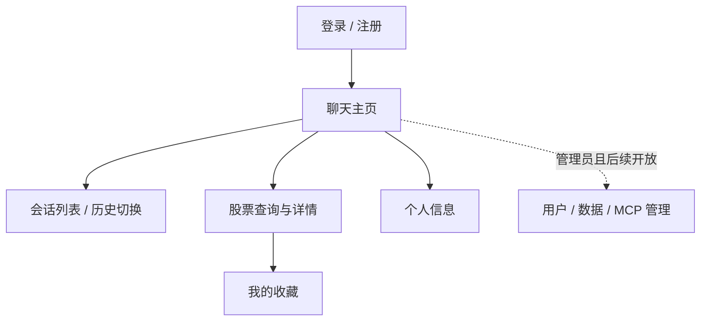

# 股票分析助手功能设计文档

版本：V1.0  
编制日期：2026-10-22  
需求依据：[REAME.md](../REAME.md)  
配套文档：[项目设计文档](项目设计文档.md)、[技术设计文档](技术设计文档.md)

## 1. 功能边界

本文件描述待实现的页面、用户操作、业务规则和验收场景。P0 为首期验收范围，P1/P2 为后续规划。首期通过浏览器访问 Streamlit，股票范围为 A 股，行情以历史日线为主。

用户登录后使用聊天、股票和收藏功能；管理员权限由后端判定。系统提供数据查询与分析，不提供交易入口。

## 2. 功能清单与原文映射

| 编号 | 功能 | 优先级 | 原文对应位置 |
| --- | --- | --- | --- |
| U01 | 注册、登录、个人信息、注销登录 | P0 | demo/user、routers/user.py |
| U02 | 用户列表、停用、删除、密码重置 | P1 | user_list.py、user_delete.py、user_reset.py |
| C01 | 新建、列出、切换、重命名、删除会话 | P0 | demo/chat/chat_list.py |
| C02 | 自然语言查询、工具分析、多轮追问 | P0 | demo/chat/chat.py、agent/stock_agent.py |
| C03 | 历史记录恢复与处理状态展示 | P0 | 对话模块、对话数据库 |
| S01 | 股票搜索与基础信息 | P0 | stock_search.py、stock_info.py |
| S02 | 历史日线与 K 线展示 | P0 | stock_kline.py |
| S03 | 股票收藏 | P0 | stock_favorite.py |
| S04 | 排名、板块、行业、分钟数据 | P1 | stock_rank.py、stock_board.py、stock_industry.py、stock_min_data.py |
| M01 | MCP 工具状态及受控诊断 | P1 | mcp_list.py、mcp_debug.py |
| D01 | 数据列表及维护 | P1 | data_list.py、data_manage.py |
| A01 | 文件、数据库、视觉、摘要等 Agent | P2 | db_agent.py、csv_agent.py、excel_agent.py、vison_agent.py、summary_agent.py |
| X01 | 新闻、天气、语录等查询工具 | P2 | api/news.py、api/saying.py、api/tool.py |

## 3. 页面与导航

聊天主页由侧边栏会话列表、消息区和输入区组成。股票详情包含股票身份、行情口径、时间范围、数据表和 K 线。所有列表提供加载、空数据、错误三类状态；功能尚未上线的页面不提供可点击入口。

## 4. 用户管理（U01/U02）

### 4.1 注册

- 输入用户名、密码、确认密码；用户名建议 3–32 字符，密码 8–128 字符。
- 用户名去除首尾空白后按不区分大小写的键去重；显示名称保留原输入大小写。
- 校验必填项、长度、密码一致性；用户名重复时拒绝创建。
- 成功后进入登录页，不自动赋予管理员权限。

### 4.2 登录与注销

- 用户输入用户名与密码，成功后进入聊天页。
- 用户不存在、密码不正确均提示“用户名或密码错误”；被停用账户不可登录。
- 令牌过期时提示重新登录；已保存历史保留，未提交输入可保留在当前页面内存。
- 注销时后端使当前令牌失效，前端清理认证状态并返回登录页。
- 个人信息页展示用户名和注册时间，不返回密码或散列值。

### 4.3 后续管理员能力

用户列表支持分页和状态筛选；停用立即阻断新请求。用户删除使用二次确认并执行预定的数据清理策略，禁止删除最后一个可用管理员。密码重置须验证操作者权限，并使旧令牌失效；不允许仅凭用户名在公开接口重置密码。

## 5. 会话管理（C01/C03）

| 操作 | 交互行为 | 业务规则 |
| --- | --- | --- |
| 新建 | 展示空白消息区 | 首条消息前可保留空会话；默认标题“新对话” |
| 列表 | 按更新时间倒序展示，分页加载 | 只列当前用户会话 |
| 切换 | 加载所选会话历史及待处理状态 | 不混用其他会话上下文 |
| 重命名 | 编辑标题并保存 | 1–100 字符；初次可取首条问题截断为标题 |
| 删除 | 确认后从列表移除 | 有处理任务时禁止删除，完成后可删除 |
| 恢复 | 刷新页面或重新登录后加载历史 | 数据以服务端持久化结果为准 |

删除为业务数据库中的会话及关联消息、工具记录删除；已产生备份按备份周期到期清理。会话不存在或不属于用户时，对外统一显示“会话不存在或不可访问”。

历史展示可分页读取全部保留消息；模型输入只使用最近最多 10 条已完成消息。界面历史长度与模型上下文长度是两个独立概念。

## 6. 智能对话（C02）

### 6.1 正常流程

1. 用户输入问题，前端生成本次请求的唯一标识后提交。
2. 页面立即显示用户消息及“分析中”，暂时禁用本会话的再次发送。
3. 后端加载本会话上下文，解析股票、日期和查询意图。
4. 有歧义时返回澄清问题；信息齐全时调用股票工具。
5. 工具返回数据后，Agent 生成解释；消息区展示回复、来源、数据时点与必要图表。
6. 用户继续追问，系统沿用最近明确确认的股票和查询范围。

例如：“查询贵州茅台 2026 年 9 月的日线行情”后追问“这一时期成交量变化如何”，应复用同一股票和月份。用户改问另一只股票时更新股票对象；“它怎么样”但无已确认对象时应澄清。

### 6.2 输入与上下文规则

- 文本长度 1–4,000 字符；纯空白不提交。
- 每个会话同时只允许一个待处理请求；不同会话可分别处理。
- 重复提交同一个请求标识不会生成重复消息或重复任务。
- 系统提示、最近最多 10 条完成消息、当前问题及已确认的股票/日期槽位共同形成输入。
- 在消息数量限制之外设置 Token 预算；优先删除最早完整轮次，再裁剪工具长表。
- 历史截断后无法确认指代时请求澄清，不能猜测用户之前的股票对象。
- 工具执行次数设置上限；超出预算或连续失败后停止并解释原因。

### 6.3 回复内容

股票数据回答应包含：股票代码及名称、查询区间、频率、复权口径、数据来源、最新数据日期、查询时间、关键数据及解释。仅进行概念解释或澄清时，无须伪造数据来源。

结论中的数值必须来自本次工具结果或明确标注的历史结果。事实、计算结果与分析判断分开描述；涨跌幅等指标应遵循技术文档中的计算口径。无数据时显示原因，不生成虚构行情。

### 6.4 状态与失败处理

| 状态 | 页面表现 | 后续操作 |
| --- | --- | --- |
| 待处理/处理中 | 显示进度提示 | 轮询状态，可切换会话 |
| 成功 | 展示完整答案 | 支持继续追问 |
| 需澄清 | 展示候选项或补充问题 | 用户回复后作为下一条消息处理 |
| 无数据 | 显示区间无记录或能力不足 | 调整日期、股票或周期 |
| 失败/超时 | 明确说明模型、工具或网络失败 | 使用新的请求标识重试，并关联原任务 |

页面轮询失败时先重新查询原请求状态，不自动创建新任务。失败的用户消息保留并展示状态，但不进入后续模型历史。

## 7. 股票功能（S01–S04）

### 7.1 股票搜索与基础资料

- 支持规范股票代码及名称关键字搜索，结果展示名称、代码、交易所和可用状态。
- 名称对应多个候选项时，展示列表供选择；不得默认选择第一项进行分析。
- 详情显示基础资料和数据来源；数据源未提供的字段显示“暂无数据”。
- 用户可直接打开详情、收藏，或带入已选股票开始分析。

### 7.2 历史行情与图表

- 选择股票、开始日期、结束日期；默认展示最近 30 个自然日范围内的可用日线。
- 首期查询跨度最多 366 个自然日，开始日期不得晚于结束日期，结束日期不得晚于当前上海日期。
- 默认不复权；支持的复权选项由适配层能力决定，并在图表和回复中持续标记。
- 展示交易日、开盘、最高、最低、收盘、成交量和成交额；字段缺失时不填 0。
- K 线与数据表使用相同数据；鼠标提示中显示价格、单位和交易日期。
- 非交易日不生成行情点；全区间无记录时展示空状态。停牌、未上市和上游缺失只在来源明确时说明具体原因。
- 分钟数据属于后续能力，启用前必须明确支持周期、日期范围和时区。

### 7.3 收藏

详情页和列表提供收藏切换。收藏属于当前用户，按添加时间倒序排列；重复添加返回既有收藏，不生成重复记录。取消收藏不删除股票详情或历史会话。

### 7.4 排名、板块和行业（后续）

排名必须同时标注指标、统计时点、股票覆盖范围、排序方向与单位。板块和行业以来源分类为准，不混用不同供应商的分类体系。数据源不支持时关闭相应入口。

## 8. 数据、工具与扩展能力（后续）

- 数据列表展示数据类型、来源、更新时间和缓存状态；维护操作只由管理员执行并记录审计。
- MCP 列表只显示已配置的工具名称、描述和健康状态；工具诊断不得接受任意 URL、任意代码或未登记工具。
- 数据库 Agent 默认只读并限制允许访问的表；文件 Agent 仅访问用户授权上传的文件。
- 新闻等文本进入模型时作为外部数据处理，不能覆盖系统权限与工具配置。
- 天气、语录及视觉分析单独验收，不作为首期股票问答完成的条件。

## 9. 权限矩阵

| 资源/操作 | 未登录 | 普通用户 | 管理员 |
| --- | --- | --- | --- |
| 注册、登录 | 允许 | 允许 | 允许 |
| 当前用户信息、注销 | 拒绝 | 本人 | 本人 |
| 股票搜索、行情查询 | 拒绝 | 允许 | 允许 |
| 会话、消息、收藏 | 拒绝 | 本人 | 本人；不默认开放其他用户对话 |
| 用户管理（P1） | 拒绝 | 拒绝 | 允许 |
| 数据维护、MCP 诊断（P1） | 拒绝 | 拒绝 | 允许 |

界面隐藏入口不能替代后端授权。管理员的运维权限不自动转化为阅读全部私人会话的权限。

## 10. 验收用例

| 编号 | 场景与操作 | 预期结果 |
| --- | --- | --- |
| AC01 | 注册有效账户，再用大小写变体重复注册 | 首次成功，重复用户名被拒绝 |
| AC02 | 错误密码登录、正确密码登录、注销后重用令牌 | 错误提示统一；正确登录；注销令牌不可再使用 |
| AC03 | 搜索股票名称并选择候选项 | 选定结果对应明确规范代码，不混用同名股票 |
| AC04 | 查询已知交易日区间 | 日线字段与源数据一致，图表单位和复权口径可见 |
| AC05 | 输入倒置日期、未来日期和超长区间 | 返回清晰校验提示，不调用外部数据源 |
| AC06 | 首问某股票某月份，继续问“它的成交量呢” | 使用同股票同区间，有来源与时点 |
| AC07 | 超过 10 条历史后询问无法确定的早期指代 | 请求澄清，历史界面仍显示已有消息 |
| AC08 | 切换两条会话并刷新页面 | 记录恢复，上下文互不混用 |
| AC09 | 使用同一请求标识重复发送 | 只产生一组消息及一个处理任务 |
| AC10 | 同会话发送第二个并发请求 | 明确提示前一请求尚未完成 |
| AC11 | 用户 B 访问用户 A 的会话、消息及收藏 ID | 不能访问或修改资源 |
| AC12 | 数据源超时、空结果、模型失败 | 分别展示可理解状态；不输出虚构数据 |
| AC13 | 重复收藏、取消收藏、重新登录 | 收藏去重，取消生效，状态持久化 |
| AC14 | 任务处理中删除会话 | 提示等待任务完成；完成后确认删除生效 |
| AC15 | 处理过程中后端重启 | 遗留任务标记失败或恢复，用户可明确重试 |

P1/P2 上线时须补充对应功能用例、角色授权用例和异常输入用例，不能使用本表推定其已验收。
