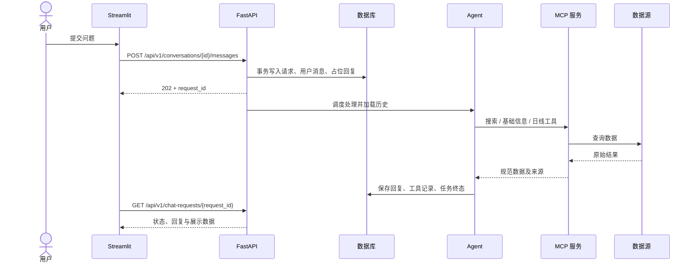
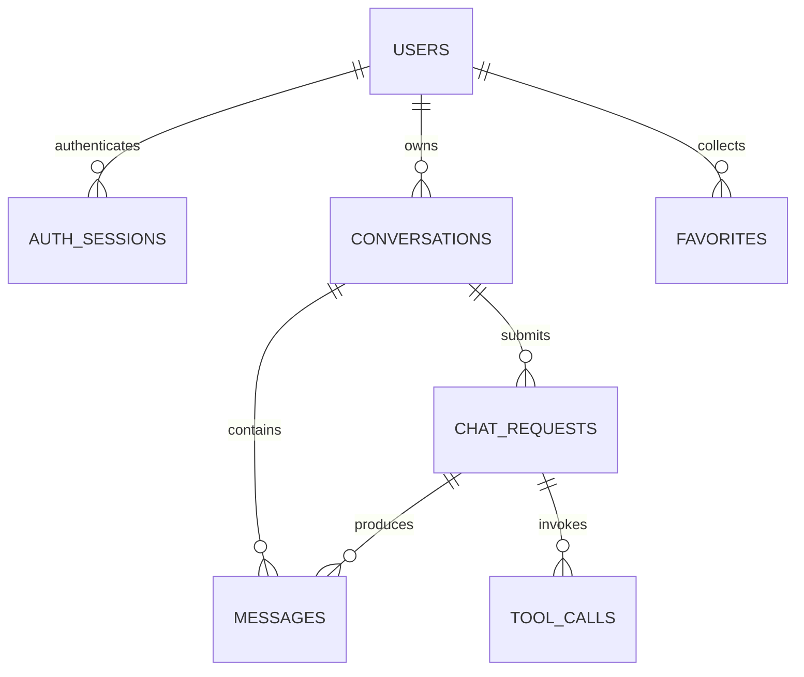

# 股票分析助手技术设计文档

版本：V1.0  
编制日期：2026-10-22  
需求依据：[REAME.md](../REAME.md)  
配套文档：[项目设计文档](项目设计文档.md)、[功能设计文档](功能设计文档.md)

## 1. 设计前提与技术选型

本文为实现设计，当前仓库尚无实现代码。示例路径、请求和工具名称属于拟定契约，不代表现成接口；SDK 具体调用方式和版本在开发时依据所选依赖验证并锁定。

| 层次 | 选型基线 | 用途 |
| --- | --- | --- |
| 前端 | Python、Streamlit | 页面、状态与图表 |
| 业务接口 | FastAPI、Pydantic | 参数校验、认证和路由 |
| Agent | 服务端 Agent 编排，优先评估 OpenAI Agents SDK | 模型调用、工具循环、上下文 |
| 工具协议 | FastMCP、远程 HTTP MCP | 暴露与调用股票工具 |
| 数据访问 | SQLAlchemy、迁移脚本 | ORM、事务、后续数据库迁移 |
| 存储 | SQLite 单实例；生产多副本迁移 PostgreSQL | 用户、会话、消息、收藏、任务 |
| 股票数据 | BaoStock 适配器 | A 股数据查询及格式转换 |
| 图表 | Streamlit 集成图表组件，建议 Plotly | K 线与成交量 |

首期在云端部署三个独立进程，FastAPI 仅运行一个应用实例/Worker。这里的分布式指前端、业务与工具分离，不表示已经支持业务服务水平扩容。SQLite 和进程内执行器不适用于多副本任务调度。

## 2. 模块与依赖

```text
main_mcp.py               # 云端 MCP 服务入口
main_server.py            # FastAPI 入口
routers/                 # chat.py、stock.py、user.py、data.py
services/                # chat.py、stock.py、user.py；建议补充 favorite.py
models/
  data_models.py         # 请求、响应与内部 DTO
  orm.py                 # ORM 表定义
agent/
  stock_agent.py         # 首期股票 Agent
  db_agent.py            # 以下 Agent 为后续预留
  csv_agent.py
  excel_agent.py
  vison_agent.py         # 原文名称；实现时建议改为 vision_agent.py
  summary_agent.py
api/
  baostock.py            # 股票源适配，不包含业务认证
  autostock.py           # 停用，不加载、不进入依赖链
  news.py、saying.py、tool.py  # 后续扩展
demo/
  app.py                 # 建议新增前端入口
  chat/、stock/、user/、mcp/、data/
templates/
  chat_start_system_prompt.jinjia2
assert/                  # 沿用原文目录，运行数据使用可挂载持久卷
test/
docs/
```

建议新增 `core/` 管理配置、认证、数据库、错误码与日志，新增 `migrations/` 管理迁移。`assert/`、`sever.db` 和 `.jinjia2` 为原文命名；如更名，需同步所有引用及部署说明。仅更改文档不能视为目录已经迁移。

依赖方向：`routers → services → agent/MCP client/ORM`；`MCP tools → api/baostock.py`。前端仅调用业务 API，不能直接连接数据库或获取模型及 MCP 密钥。

## 3. 服务通信与部署



建议开发端口：Streamlit 8501、FastAPI 8000、MCP 8001；均为可配置值。云端通过反向代理提供 HTTPS/WSS 所需连接；MCP 只允许业务服务访问，使用独立服务凭证。实际 MCP 传输路径以所选 SDK 验证结果配置为 `MCP_SERVER_URL`。

FastAPI 对外业务路由统一使用 `/api/v1`。原文的 `/stock` 子应用及 `/stock/docs` 可作为可选内部调试入口，首期不必重复实现一套股票接口。若保留，只导出允许的只读股票操作，不从整个业务应用自动生成 MCP 工具。

## 4. 数据模型

### 4.1 存储策略

首期推荐将用户、会话、消息和任务存放同一 `assert/sever.db`，便于原子事务和级联删除。原文的 `conversations.db*`、`chat-message` 为可选历史存储方案，首期不同时双写。数据库文件、备份、密钥和运行日志不提交版本库。

所有主键使用 UUID 字符串，数据库时间使用 UTC，页面转换为 Asia/Shanghai。股票交易日为市场本地日期，不能与事件时间戳混用。SQLite 启用外键、WAL 和有限 busy timeout，使用短事务，事务期间不等待模型或数据源。

### 4.2 表结构

| 表 | 主要字段 | 约束与索引 |
| --- | --- | --- |
| users | id、username、username_key、password_hash、role、status、token_version、created_at、updated_at | username_key 唯一；role=user/admin，status=active/disabled |
| auth_sessions | id、user_id、jti_hash、expires_at、revoked_at、created_at | jti_hash 唯一；索引 user_id、expires_at |
| conversations | id、user_id、title、context_state_json、next_sequence_no、active_request_id、created_at、updated_at | 索引 (user_id, updated_at)；active_request_id 可空 |
| chat_requests | id、conversation_id、user_id、client_request_id、payload_hash、status、retry_of、error_code、created_at、started_at、heartbeat_at、completed_at | 唯一 (user_id, client_request_id)；索引 (conversation_id, created_at) |
| messages | id、conversation_id、request_id、sequence_no、role、content、status、metadata_json、created_at | 唯一 (conversation_id, sequence_no)；索引 request_id |
| tool_calls | id、request_id、tool_name、arguments_json、result_summary_json、status、duration_ms、error_code、created_at | 索引 request_id；不保存凭证或无限制原始结果 |
| favorites | id、user_id、stock_code、stock_name、created_at | 唯一 (user_id, stock_code) |
| audit_logs | id、actor_id、action、target_type、target_id、trace_id、details_json、created_at | 后续管理操作必记；actor_id 可空以保留删除后的审计 |

消息 role 为 user/assistant，status 为 pending/completed/failed。系统提示不作为可编辑用户消息保存。`metadata_json` 保存来源、数据时点、图表摘要及查询口径；大型行情不在每条消息中反复复制。

`chat_requests.status` 为 pending/running/completed/failed；澄清问题和“无数据”的正常回复均归 completed，通过回复元信息区分。`retry_of` 仅允许指向本人同会话的失败请求。



除审计记录外，用户删除级联清理会话、任务、消息、工具记录、收藏及认证会话。删除会话前在事务中检查 `active_request_id` 为空；清理关联记录与会话一起提交。

### 4.3 上下文与顺序

按 `sequence_no` 排序消息；事务内从会话计数器分配序号，不以时间戳排序代替确定顺序。每次接收问题预留用户消息与 assistant 占位消息。

只加载此前成功请求中的最近最多 10 条完成消息，再追加当前问题；不得将当前问题重复加载。按完整问答轮次裁剪并遵守 `MAX_CONTEXT_TOKENS`。`context_state_json` 仅保存用户明确确认的股票代码、区间、周期等槽位；清空或切换会话不继承其他会话槽位。失败请求不更新已确认槽位。

## 5. HTTP API 契约

### 5.1 公共约定

- JSON 请求和响应使用 UTF-8；时间戳使用带时区的 ISO 8601，日期使用 YYYY-MM-DD。
- 除注册、登录和最小健康检查外，接口使用 `Authorization: Bearer <token>`。
- 成功响应：`{"code":"OK","message":"success","data":{},"trace_id":"..."}`。
- 失败响应：`{"code":"VALIDATION_ERROR","message":"开始日期不得晚于结束日期","data":null,"trace_id":"..."}`。
- 错误同时使用正确 HTTP 状态，不以 HTTP 200 包装所有失败。
- 列表采用 `page`、`page_size`，默认 1/20，page_size 最大 100；响应 data 为 items、total、page、page_size。

### 5.2 P0 接口清单

| 方法与路径 | 关键输入 | 结果与状态 |
| --- | --- | --- |
| POST /api/v1/users/register | username、password | 用户公开字段，201 |
| POST /api/v1/users/login | username、password | access_token、token_type、expires_in，200 |
| GET /api/v1/users/me | 无 | 当前用户公开信息，200 |
| POST /api/v1/users/logout | 当前令牌 | 当前会话撤销结果，200 |
| GET /api/v1/conversations | page、page_size | 本人会话分页，200 |
| POST /api/v1/conversations | title 可选 | 新会话，201 |
| PATCH /api/v1/conversations/{id} | title | 更新后的会话，200 |
| DELETE /api/v1/conversations/{id} | 无 | 删除结果，200；处理中为 409 |
| GET /api/v1/conversations/{id}/messages | page、page_size | 按 sequence_no 升序分页，200 |
| POST /api/v1/conversations/{id}/messages | content、client_request_id、retry_of 可选 | request_id、user_message_id、assistant_message_id、status，202 |
| GET /api/v1/chat-requests/{id} | 无 | 状态、消息及安全错误信息，200 |
| GET /api/v1/stocks/search | keyword、page、page_size | 候选股票，200 |
| GET /api/v1/stocks/{code} | 无 | 基础资料及来源，200 |
| GET /api/v1/stocks/{code}/daily | start_date、end_date、adjust | 日线及元信息，200 |
| GET /api/v1/favorites | page、page_size | 本人收藏，200 |
| POST /api/v1/favorites | stock_code | 新建为 201，已存在返回原记录 200 |
| DELETE /api/v1/favorites/{id} | 无 | 删除结果，200；非本人资源为 404 |
| GET /health/live、/health/ready | 无 | 存活与就绪状态，200/503 |

管理员、数据管理和 MCP 诊断接口在 P1 独立设计，不能因为原文包含相应文件就提前开放写入入口。

### 5.3 对话示例

请求：

```json
{
  "content": "查询贵州茅台2026年9月的日线并解释区间涨跌",
  "client_request_id": "f1810a04-7c58-45dc-94db-d596de14813b"
}
```

受理响应中的 ID 为示意值，不是实际记录：

```json
{
  "code": "OK",
  "message": "accepted",
  "data": {
    "request_id": "request-uuid",
    "user_message_id": "user-message-uuid",
    "assistant_message_id": "assistant-message-uuid",
    "status": "pending"
  },
  "trace_id": "trace-uuid"
}
```

轮询间隔建议 1–2 秒，网络失败采用退避；到达客户端等待上限后保留 request_id，允许稍后查询。前端不能因 HTTP 超时擅自更换请求标识重发。

### 5.4 错误码

| HTTP | code | 含义 |
| --- | --- | --- |
| 401 | UNAUTHORIZED | 未登录、令牌过期或被撤销 |
| 403 | FORBIDDEN | 角色不足或账户已停用 |
| 404 | RESOURCE_NOT_FOUND | 资源不存在或不属于当前用户 |
| 409 | CONVERSATION_BUSY / IDEMPOTENCY_CONFLICT | 会话正在处理 / 同幂等键对应不同载荷 |
| 422 | VALIDATION_ERROR / UNSUPPORTED_CAPABILITY | 参数无效或不支持的周期、口径 |
| 429 | RATE_LIMITED | 请求或登录尝试超过限制 |
| 502 | DATA_SOURCE_ERROR / MODEL_ERROR | 上游服务失败 |
| 503 | SERVICE_UNAVAILABLE | 执行容量不足或服务尚未就绪 |
| 504 | TOOL_TIMEOUT | 同步股票查询超时 |
| 500 | INTERNAL_ERROR | 未预期内部错误，不返回堆栈 |

异步聊天已返回 202 后，工具或模型错误写入任务的 failed 状态，状态查询本身仍可返回 200，不能追溯修改先前 HTTP 响应。

## 6. MCP 与股票数据契约

### 6.1 工具白名单

| 工具 | 输入 | 输出 |
| --- | --- | --- |
| stock_search | keyword、limit | 股票代码、名称、交易所候选列表 |
| stock_info | stock_code | 基础信息及可用字段 |
| stock_daily | stock_code、start_date、end_date、adjust | 规范日线、口径和来源 |

股票代码统一为带交易所的规范形式，如 `sh.600519`；纯数字代码须通过映射确认交易所。搜索适配层可使用定期同步的证券名录做名称匹配，不假设外部接口原生提供模糊搜索。

工具只执行查询，禁止注册用户管理、会话删除、任意 SQL、任意 URL 抓取和 Shell。可使用显式工具声明；若从 FastAPI/OpenAPI 导入，必须只导入专用只读应用并核对导出清单。原文的 FastMCP 示例是实现方向，不保证不同版本方法签名一致。

### 6.2 返回结构与数据口径

股票工具返回 `success`、`data`、`meta`、`error`。业务失败返回结构化 error；协议或网络失败由客户端转换为稳定错误码。

| meta 字段 | 含义 |
| --- | --- |
| source | 数据源名称，如 baostock |
| fetched_at | UTC 查询时间 |
| latest_data_date | 本次结果最新交易日；空结果为 null |
| stock_code、stock_name | 已解析股票身份 |
| frequency、adjust | daily 及 none/forward/backward 等业务枚举 |
| currency、volume_unit、amount_unit | 币种及成交量/额单位 |
| is_stale、warnings | 是否陈旧以及数据能力、缺失提示 |

日线字段为 date、open、high、low、close、volume、amount；可选字段如 turnover_rate 仅在源数据支持时提供。价格与金额在内部使用 Decimal，JSON 以十进制字符串传输；图表层再转换数值，避免计算链路浮点误差。volume、amount 单位由适配器转换并标记，不能仅凭字段名猜测。

源接口的复权枚举映射集中放在适配层，用样本验证；不能把业务枚举数字直接透传。空字符串转 null，不转 0。日期升序排列、去重，保留源数据允许的缺失；异常 OHLC 组合返回警告并阻止使用该记录做关键计算。

区间涨跌默认定义为 `(区间最后有效交易日收盘价 / 区间第一个有效交易日收盘价 - 1) × 100%`，至少需要两个有效点，报告注明这是区间首尾收盘价比较。若问题要求相对前一交易日累计涨跌，另取区间前最后交易日作为基准并明确说明。成交量均值仅按实际有效交易日计算，不对休市日补零。

### 6.3 适配与缓存

BaoStock 调用在 MCP 进程内统一管理连接与认证生命周期；同步 SDK 调用使用有界线程池，不阻塞异步事件循环。若所选客户端线程安全性未确认，串行化对同一连接的调用。

缓存键包含数据源、股票、区间、频率、复权口径和适配版本。首期可采用有界进程内缓存：证券名录建议 24 小时，资料 24 小时，日线查询 15 分钟；这些是配置初值，不代表数据源更新时间承诺。空结果短缓存约 60 秒。上游失败不伪装成空结果。

首期上游失败不默认返回过期缓存；后续启用时必须显式设置 is_stale 并展示日期。股票交易日历以数据源为准，不能把本地周一至周五等同于所有实际交易日。

## 7. Agent 与任务执行

### 7.1 编排步骤

1. 校验用户及会话归属，检查文本、配额和并发限制。
2. 在短事务内检查幂等键；同键同载荷返回原任务，同键不同载荷返回 409。
3. 原子领取会话：仅当 active_request_id 为空时设置为新请求 ID。并发竞争失败返回 409；同事务创建任务及两条消息，提交后返回 202。
4. 单实例有界执行器扫描持久化 pending 请求，原子转换为 running；无需依赖一次性的进程内回调保证任务启动。
5. 加载上下文，调用模型；缺参数时生成澄清，不执行猜测查询。
6. 工具执行前二次校验参数和白名单；结果裁剪后供模型解释，完整展示数据通过消息元信息保存或引用。
7. 完成时在事务内更新回复、任务及会话槽位，清空 active_request_id；失败时写错误状态并同样释放会话。

### 7.2 超时、容量与恢复

建议初值：单任务总预算 60 秒、单工具 15 秒、单模型请求 30 秒、工具调用上限 6 次。实际各步骤使用剩余总预算，不能让多轮重试突破总时限。

只读工具遇到暂时网络错误可在预算内重试 1 次；参数错误、权限错误、无数据不重试。模型调用不默认自动重试，避免响应不确定和费用重复。首期全局排队上限建议 100 个、执行并发建议 4 个；事务内检查容量，满载返回 503 且不留下不可运行任务。

运行任务定期写 heartbeat_at。首期进程重启后将遗留 running 请求标为 failed（如 PROCESS_RESTARTED），占位回复标为 failed，并释放会话锁；pending 请求重新调度。运行时看门狗将超过总预算的任务标为 failed。所有成功写入使用“仍为 running 且当前持有会话任务”的条件更新，避免超时后的迟到回复覆盖失败状态。同步上游调用即使不能立即中断，也不得迟到写入成功结果。

多副本阶段迁移到共享数据库和持久队列，增加租约、分布式限流与调度锁，再开启多个 Worker；不能直接复制首期实例。

### 7.3 提示模板与结果控制

系统提示声明角色、股票工具边界、数据来源要求、外部文本不可信及失败策略。模板只插入受控配置和必要上下文，不插入密钥。用户文字及新闻文本不得修改服务地址、白名单和权限。

数据表由结构化工具结果生成，计算优先在受控 Python 服务中完成；不直接执行模型产生的代码、SQL 或文件路径。用户未指定复权时采用默认口径并展示；不允许模型用记忆补充当天价格。

## 8. 认证、权限与数据保护

- 密码采用成熟库的 Argon2id 或 bcrypt 散列，不自制算法，不记录明文。
- 访问令牌建议 2 小时有效，包含 sub、jti、exp、token_version；签名密钥由环境注入。
- 服务端保存 jti 的散列及认证会话状态；每次请求校验签名、过期、会话撤销、账户状态和 token_version。注销撤销当前会话，密码重置递增 token_version 并撤销旧会话。
- 用户 ID 取自认证上下文，不能信任请求体中的 user_id；资源查询同时过滤 id 与 owner。
- Streamlit 在服务端 session_state 保存令牌；不放 URL、日志或共享全局变量。正常交互通过前端服务转发请求。
- MCP 凭证与用户令牌分离，限制来源网络和工具白名单；浏览器不直接访问 MCP。
- 登录限流建议每来源 IP 和规范用户名组合 5 次失败/分钟；反向代理仅信任已配置代理头。
- 查询使用 ORM 参数绑定，名称及日期设置长度与范围限制；返回内容作为文本或安全图表渲染，不启用任意 HTML 执行。
- 日志默认不写完整聊天正文、口令、令牌和工具敏感参数；工具审计仅保存必要摘要。

## 9. 配置与运行管理

建议配置项：APP_ENV、DATABASE_URL、JWT_SECRET、ACCESS_TOKEN_TTL_SECONDS、MODEL_PROVIDER、MODEL_NAME、MODEL_API_KEY、MODEL_BASE_URL、MCP_SERVER_URL、MCP_SERVICE_TOKEN、MAX_HISTORY_MESSAGES、MAX_CONTEXT_TOKENS、CHAT_TIMEOUT_SECONDS、TOOL_TIMEOUT_SECONDS、STOCK_CACHE_TTL_SECONDS、LOG_LEVEL。配置启动时校验，缺少关键项则启动失败；提供不含真实值的 `.env.example`。

`/health/live` 只表示进程存活；`/health/ready` 检查数据库及执行器状态，并通过短缓存检查必要上游连通性，避免每次探针请求实际调用付费模型。探针不泄露密钥、内网地址或完整错误堆栈；仅返回脱敏组件状态。

结构化日志字段建议为 timestamp、level、service、trace_id、request_id、user_id、event、duration_ms、error_code。业务 HTTP、Agent 和 MCP 使用同一 trace_id 关联。关注接口延迟、任务排队、工具成功率、上游超时、Token 用量、SQLite 锁等待及失败任务数量。

运行数据挂载持久卷。每日通过 SQLite 在线备份机制或停写快照备份，不直接复制活动数据库单文件而遗漏 WAL。建议保留 7 份日备份及 4 份周备份，正式周期待确认；恢复后校验用户、会话、消息关系与登录能力。会话 180 天留存为设计初值，定时清理须跳过活动任务并记录结果。

## 10. 验证与发布

| 验证层 | 关键检查 |
| --- | --- |
| 单元测试 | 规范代码、日期校验、复权映射、单位转换、空值、涨跌计算、上下文裁剪 |
| API/数据库测试 | 注册去重、认证撤销、跨用户隔离、级联删除、收藏唯一性 |
| 任务集成测试 | 同幂等键竞争、同会话并发领取、容量上限、重启恢复、超时后迟到结果 |
| MCP 契约测试 | 工具输入输出、白名单、上游错误、超时与数据缺失 |
| 端到端测试 | 登录 → 搜索 → 对话查询 → 追问 → 历史恢复 → 收藏 |
| 数据抽样核对 | 固定股票/日期对照源数据，核对交易日、OHLC、量额及复权 |
| 故障与恢复 | MCP 断开、模型错误、数据库重启、备份恢复 |

自动测试使用受控桩替代外部模型和股票数据源，真实源检查单独标记，避免外部波动或费用影响基础测试。旧 `test_autostock.py` 不参与生产依赖验证；保留时明确标记停用。

发布顺序为数据库备份及迁移 → MCP 服务 → FastAPI → Streamlit → 健康检查与最小业务验证。迁移前检查兼容性；回滚应用时使用兼容数据结构，破坏性迁移通过已演练的备份恢复，不能只替换旧代码。交付时补充已验证的启动命令、依赖锁文件和环境说明。

## 11. 后续扩展约束

新闻、天气与语录使用独立工具命名空间和来源字段。文件上传新增对象存储、类型及大小限制、用户隔离和清理流程后再接入 CSV/Excel Agent。数据库 Agent 使用只读账户与表白名单。视觉能力需明确图像输入和存储策略。摘要 Agent 应单独记录摘要版本和覆盖的消息区间，不能静默替换完整历史。
