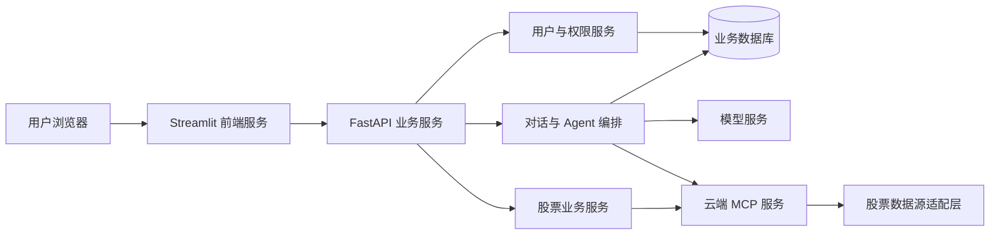

# 股票分析助手项目设计文档

版本：V1.0  
编制日期：2026-10-22  
需求依据：[REAME.md](../REAME.md)  
配套文档：[功能设计文档](功能设计文档.md)、[技术设计文档](技术设计文档.md)

## 1. 文档定位与现状

本文确定项目目标、范围、总体方案、实施计划与验收边界，供需求确认和开发排期使用。

当前项目目录仅有 REAME.md，原文中的文件树代表预期结构，不代表已实现功能。本文中的架构、存储、接口及指标均为建议采用的设计基线，需要通过开发和测试落地。原文未明确的决策在本文中显式列出。

## 2. 项目背景与目标

传统 BI 和股票分析工具通常需要用户理解查询条件、指标配置和图表操作。对于临时查询和连续追问，交互成本较高。本项目以自然语言为入口，让用户通过云端股票工具和大模型完成查询、对比和解释。

核心目标：

1. 用户通过浏览器使用系统，无须在个人电脑部署 Agent 或 MCP 服务。
2. 服务端 Agent 调用云端 MCP 股票工具，基于可追溯的数据回答问题。
3. 支持多轮对话、会话切换及历史记录持久化。
4. 提供股票搜索、基础资料、历史行情图表和个人收藏入口。
5. 分离前端、业务服务与工具服务，便于独立部署和后续扩展。

首期不包含证券交易、自动下单、收益承诺或实时行情 SLA。

## 3. 用户角色与场景

| 角色 | 诉求 | 典型场景 |
| --- | --- | --- |
| 普通用户 | 快速查询并理解股票数据 | 查询某股票近一个月走势，再追问成交量变化 |
| 注册用户 | 保存个人使用状态 | 切换历史会话、管理收藏、继续分析 |
| 管理员 | 维护账户和数据、查看工具状态 | 停用异常账户、查看 MCP 连通情况 |
| 开发与运维人员 | 部署、排障和扩展工具 | 更换数据源、定位工具超时、发布服务 |

首期所有业务查询要求登录；管理员功能由服务端角色校验保护。开发与运维人员不等同于业务系统管理员，不通过前端获取密钥。

## 4. 建设范围与优先级

### 4.1 首期必须交付（P0）

| 模块 | 建设内容 | 交付边界 |
| --- | --- | --- |
| 用户管理 | 注册、登录、当前用户信息、注销登录 | 密码散列存储，令牌认证 |
| 股票查询 | 名称/代码搜索、基础信息、日线行情 | 首期聚焦 A 股，查询能力由数据源适配层确认 |
| 智能对话 | 自然语言查询、工具调用、多轮追问 | 采用云端 Agent；默认最多取最近 10 条完成消息 |
| 历史记录 | 新建、列出、切换、重命名、删除会话 | 用户只能访问自己的数据 |
| 收藏管理 | 添加、取消、查看收藏 | 同一用户不能重复收藏同一股票 |
| MCP 服务 | 股票查询工具、受控访问、错误处理 | 与用户注册、登录等业务接口分离 |
| 前端 | 登录注册、聊天页、股票页、收藏页 | Streamlit 调用 FastAPI，浏览器不持有服务密钥 |
| 运行保障 | 配置管理、日志、健康检查、部署说明 | 能独立启动三类服务并完成端到端演示 |

### 4.2 后续迭代（P1/P2）

| 能力 | 优先级 | 前置条件 |
| --- | --- | --- |
| 用户列表、停用、删除与密码重置管理 | P1 | 角色权限、审计与重置流程完善 |
| 数据列表、缓存失效与数据维护 | P1 | 缓存和审计机制稳定 |
| 股票排名、板块与行业页面 | P1 | 数据源覆盖范围、更新频率明确 |
| 分钟行情 | P1 | 明确周期、历史范围和时效；不承诺实时 |
| 新闻、天气、名言等 MCP 扩展工具 | P2 | 独立数据源、工具白名单及来源标记 |
| CSV、Excel、数据库、视觉与摘要 Agent | P2 | 输入格式、访问权限与专项需求确认 |

原文列出的演示文件全部保留为规划映射，未进入 P0 的页面不应在首期显示为可用。旧版 autostock 接口停用，不作为生产依赖。

## 5. 设计基线与待确认事项

以下决策用于让首期方案可以直接实施，属于设计补充，不是原文已经确定的事实。

| 事项 | 首期基线 | 变更影响 |
| --- | --- | --- |
| 股票市场 | A 股；BaoStock 为优先数据源 | 扩展市场需增加代码规范和数据适配器 |
| 行情时效 | 历史日线为主，展示数据日期及查询时间 | 实时行情需要另选数据源及服务等级 |
| 模型提供方 | 服务端配置兼容的模型服务；接口封装 | 具体供应商、模型和费用上线前确认 |
| 会话状态 | 自行管理历史与持久化 | 暂不同时引入 AdvancedSQLiteSession |
| 数据库 | 单后端实例使用 SQLite，预留 PostgreSQL 迁移 | 多副本部署前必须迁移数据库和共享缓存 |
| 响应方式 | 同步提交消息并轮询处理结果 | 流式输出作为后续增强 |
| 密码恢复 | P0 由运维离线流程支持；不提供公开重置接口 | 自助找回需接入身份验证渠道 |
| 文件上传 | P0 不开放 | CSV/Excel Agent 另行设计大小限制和隔离 |
| 数据留存 | 用户可删除会话；建议历史默认保留 180 天 | 正式留存及备份周期上线前确认 |

若数据源不支持某字段或周期，系统返回明确的能力限制，不以模型生成内容补齐。

## 6. 总体方案

三类服务职责：

- **Streamlit**：负责页面、交互、会话选择、数据及图表展示。
- **FastAPI**：负责认证授权、用户数据、会话管理、任务状态和 Agent 编排。
- **MCP Server**：提供受控的外部查询工具，屏蔽数据源差异，返回结构化结果。

股票页面和 Agent 共用 MCP 查询能力。用户注册、登录、收藏写入和会话删除通过业务 HTTP API 完成，不注册为模型工具。

## 7. 端到端业务闭环

1. 用户注册并登录，前端获取访问令牌。
2. 用户创建会话，输入股票问题。
3. 后端检查会话归属，保存消息，加载受限历史上下文。
4. Agent 解析股票、日期和指标；必要时请求用户补充或确认。
5. Agent 调用云端 MCP 工具；工具获取并规范化股票数据。
6. 后端保存回复、来源、数据时点和工具执行摘要。
7. 前端轮询结果并展示回答、数据表和图表。
8. 用户继续追问或切换会话；页面刷新后仍可恢复已保存的记录。

## 8. 非功能目标

下列指标为验收目标，测试环境需记录硬件、数据量和外部服务耗时。

| 维度 | 目标 |
| --- | --- |
| 普通业务接口 | 10 个并发用户条件下，排除外部服务的接口 P95 ≤ 1 秒 |
| 对话受理 | 返回任务标识的接口 P95 ≤ 1 秒；完整回答取决于外部服务 |
| 对话处理 | 单次处理预算 60 秒，超时后任务可查询、可重试 |
| 数据正确性 | 固定股票与日期样本中，返回字段、单位和复权口径与数据源一致 |
| 隔离性 | 用户不能通过修改 ID 读取或修改他人会话、消息和收藏 |
| 可追溯性 | 股票事实附来源及数据日期；失败请求可按 trace_id 定位 |
| 可维护性 | 路由、业务、Agent、工具与外部 API 分层，配置和密钥不写入源码 |
| 恢复性 | 每日备份数据库，至少完成一次恢复演练 |

## 9. 实施计划

原文给出的 MCP 2–3 天、后端 3–4 天、前端 1–2 天对应基础开发约 6–9 个工作日。下表补充需求与联调工作，单人串行估算约 9–13 个工作日，不构成固定工期承诺。

| 阶段 | 估算 | 主要产物 | 完成条件 |
| --- | --- | --- | --- |
| 需求与模型定稿 | 1 天 | 三份设计文档、接口和 ORM 清单 | P0 范围、数据源限制明确 |
| MCP 工具开发 | 2–3 天 | 股票搜索、基础信息、日线工具 | 真实样本和异常输入验证通过 |
| FastAPI 后端 | 3–4 天 | 用户、会话、收藏、Agent 与持久化 | 权限、失败和重试流程通过 |
| Streamlit 前端 | 1–2 天 | 登录、聊天、股票及收藏页面 | 可完成核心用户路径 |
| 联调与验收 | 2–3 天 | 集成测试、部署说明、验收记录 | 完整闭环及故障恢复可演示 |

建议按“模型与契约 → 查询工具 → 业务服务 → Agent → 页面 → 联调”推进；不要以演示页数量代替核心链路完成度。

## 10. 风险与应对

| 风险 | 影响 | 应对 |
| --- | --- | --- |
| 数据源缺字段、延迟或不可用 | 回答不完整或过时 | 能力检查、来源时间展示、缓存、明确失败状态 |
| 大模型生成未经查询的股票数值 | 用户误解分析依据 | 数值仅取工具结果，提示模板要求事实与解释分开 |
| 上下文截断 | 追问指代失效 | 保留最近历史与已确认股票槽位，缺失时澄清 |
| SQLite 并发写限制 | 多副本时出现锁冲突 | 首期限制单后端实例，多副本前迁移数据库 |
| 远程工具超时或重复提交 | 重复回答、成本增加 | 任务状态、幂等键、有限重试与超时预算 |
| 规划范围扩大 | 影响按期交付 | 先验收 P0，扩展 Agent 和数据页面单独排期 |

## 11. 项目验收与交付

首期验收必须覆盖：注册登录；按名称查询股票；生成有来源的日线分析；跨多轮追问；切换及恢复历史；收藏去重；跨用户访问拒绝；数据源故障提示；服务重启后记录可恢复。

交付物包括源代码、三份设计文档、依赖及环境变量示例、数据库初始化/迁移脚本、自动化测试与测试记录、三服务启动及部署说明。版本号和依赖锁文件应随实现交付，本文不预先指定未经验证的软件版本。

成本由应用计算资源、数据库与备份、模型 Token、数据源配额和日志存储构成。正式部署前根据实际调用量测算；本文不假设原文未提供的预算或价格。
