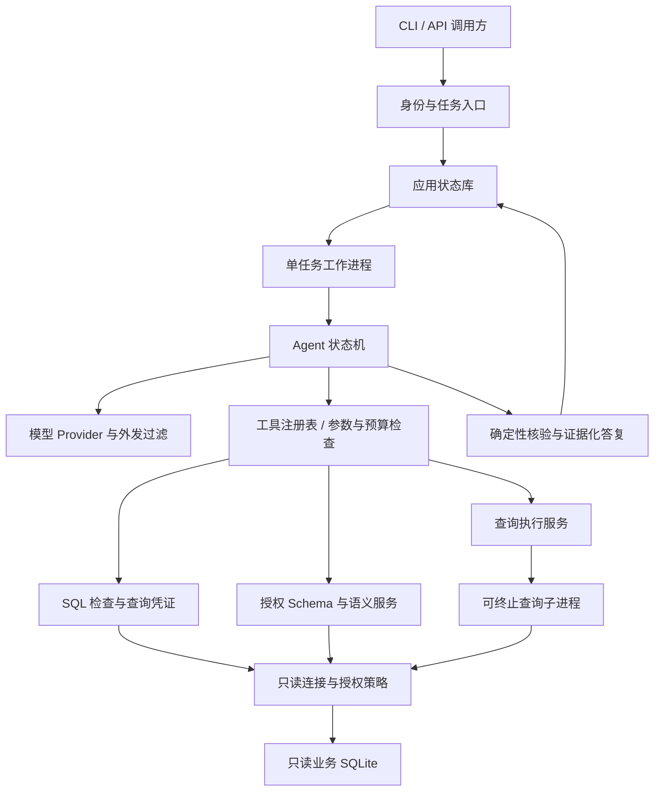

# DataAgent 技术设计文档

版本：V1.0｜日期：2026-10-22｜状态：拟建架构；代码现状与目标实现明确区分

配套文档：[项目设计文档](项目设计文档.md)、[功能设计文档](功能设计文档.md)。本文回答“现有代码如何改造、接口与状态如何定义、如何保证安全和验证交付”。

## 1. 技术结论与约束

保留现有“结构读取、选表、SQL 生成、修复、总结”的业务经验，把数据库访问、模型访问和工作流拆成独立组件。通过一个显式状态机驱动有限动作；工具执行必须经过服务端授权、输入校验和预算检查。

MVP 采用单组织、单个启用的 SQLite 业务数据源、一个任务工作进程、CLI/API 访问。业务库全程只读，应用状态另存；先采用状态轮询，无需引入消息中间件或持久化向量库。

本设计未实施任何业务代码改造。真实模型、数据库性能和端到端正确率仍需联调与评测。当前分析的两份原文件没有被修改。

### 1.1 关键架构决策

| 决策 | 选择与理由 | 后续替换条件 |
| --- | --- | --- |
| Agent 编排 | 自有显式状态机；动作集合固定，方便控制与回放 | 出现大量分支、外部长事务或多人协作再评估框架 |
| SQL 方言 | SQLite 首先验收，不将 DBParser 的类型判断视为多库支持 | 第二种方言需实现独立连接、超时、权限与语义测试 |
| API | 拟用 FastAPI；CLI 调用同一应用服务 | 与现有平台集成时保留服务协议，可替换入口 |
| 协议校验 | 拟用 Pydantic 的严格模型，拒绝额外字段 | 模型提供商支持结构化输出时仍保留本地校验 |
| SQL 结构检查 | 拟用 SQLGlot 解析 AST，加数据库编译检查与连接授权 | 特定方言不被正确解析时失败关闭或替换适配器 |
| 元数据访问 | 保留 SQLAlchemy 反射经验，去除全库逐列统计启动流程 | 结构特别大时再增加索引检索 |
| 任务存储 | 独立应用 SQLite；小规模单工作进程 | 出现多实例、高并发写入后迁移服务型状态库 |
| 查询隔离 | 独立子进程执行单次 SQLite 查询，可截止、取消和回收 | 大规模时改为受资源限制的容器/工作节点 |
| 模型适配 | 单一 Provider 接口，配置地址、模型、超时和重试 | 不把现有源码模型字符串当作可用性证明 |

FastAPI 和 Pydantic 在此分别承担 HTTP 入口与结构约束；其官方说明见 [FastAPI 用户指南](https://fastapi.tiangolo.com/tutorial/) 和 [Pydantic Models](https://docs.pydantic.dev/latest/concepts/models/)。依赖版本需在目标环境验证后锁定，本文不推荐未经验证的“最新版本”组合。

## 2. 现有代码的可复用部分与改造点

| 现有位置 | 复用价值 | 改造方案 |
| --- | --- | --- |
| `SQLAgent.__init__`，第 14 行 | 数据源存在性检查、最终只读 URI | 先验证配置再创建服务；移出全库扫描；客户端与数据连接依赖注入 |
| `_ask_deepseek`，第 33 行 | 模型调用封装起点 | 改为 Provider，返回标准输出、usage、耗时与错误；外层预算控制 |
| `_clean_sql`，第 46 行 | 围栏兼容 | 作为有限兼容层；主路径采用结构化输出，不靠清洗修复任意响应 |
| `get_schema_context`，第 58 行 | 汇总字段与关系 | 改为授权 SchemaService；样例按需且脱敏，保存版本与更新时间 |
| `select_tables`，第 81 行 | JSON 数组解析与真实表名归一 | 引入字段约束和关联路径闭包；不把选表结果当作权限 |
| `generate_sql` / `rewrite_sql`，第 143/202 行 | SQLite 提示与错误反馈 | 输入结构化需求，输出 SQL 与参数；按错误分类允许修复 |
| `validate_sql`，第 177 行 | 早期空输入检查 | 重写为 AST + 名称解析 + 授权 + 受限 EXPLAIN，删除实际执行业务 SQL 校验 |
| `execute_sql`，第 237 行 | 行列表与列名返回格式 | 统一连接工厂；校验 ID 绑定；取 N+1 行、超时与实际 SQL 留证 |
| `summarize`，第 260 行 | 真实结果作答提示 | 先做外发过滤；结构化数值引用；模板降级；保留证据 |
| `run`，第 289 行 | 有限校验修复循环与阶段进度 | 迁移至持久化状态机；添加澄清、补查、取消、超时与错误返回 |
| `DBParser.__init__`，第 7 行 | 表字段与外键反射 | 拆成轻量结构加载和可选画像；避免逐字段扫描；上下文管理连接 |
| `DBParser.check_sql`，第 116 行 | 错误信息反馈 | 移除其执行式实现；禁止编排器继续调用旧方法 |
| `DBParser.execute_sql`，第 132 行 | 通用查询方法形式 | 删除或降为受控执行服务的私有路径，不能成为绕过口 |

### 2.1 现状离线证据

[复现脚本](evidence/verify_current_code.py) 对原类方法做了 9 项行为断言，结果保存在 [JSON 记录](evidence/current_code_observations.json)。覆盖：WITH 写语句放行和连接内写入、未选表可校验与可执行、恰好 50 行的错误截断标志及返回数、字面量分号误拒、执行路径拒绝写语句、空文本表初始化异常。

该脚本绕过未安装的 `openai` 导入及构造器，仅在临时数据库运行。它不是模拟修复后的安全测试，亦不证明真实库已被修改或模型链路可用。改造后应建立独立的正向验收测试，不能只让“缺陷仍然存在”的旧断言通过。

### 2.2 性能与可靠性现状

初始化时 DBParser 对每个非文本字段约发起 5 次统计/取值查询，文本字段额外增加众数查询；还包含逐表样例和反射开销。统计查询数量与列数相关，实际代价与行数、索引和字段分布有关。当前所谓 `random` 是前十条取值去重，不是真正随机抽样。

DBParser 只取一行样例，`get_schema_context().head(3)` 不会凭空得到三行。每次 `run()` 使用的字段统计来自初始化缓存，存在陈旧问题。

现有单次成功流程通常包含选表、生成和总结共 3 次模型请求；两次修复时为 5 次，不包括 SDK 自带重试。未显式配置请求超时和重试，不能据此认定 SDK 没有默认行为。当前查询在 `check_sql` 和正式执行中各运行一次，既增加代价，也可能因连接与数据快照不同而产生差异。

## 3. 分层架构与建议目录



```text
dataagent/
  pyproject.toml                  # 拟建：依赖、CLI 入口和开发工具
  dependency-lock.*              # 拟建：验证后生成实际锁文件
  .env.example                   # 拟建：无密钥的配置样例
  src/dataagent/
    api/                         # 任务、会话、数据源接口与鉴权
    application/                 # CLI/API 共用的应用服务
    agent/                       # 状态、动作、编排、预算、恢复规则
    models/                      # 请求、动作、结果、证据和错误协议
    providers/                   # 模型服务适配器
    schema/                      # 结构加载、缓存和检索
    semantics/                   # 指标、同义词、关联与时间规则
    tools/                       # 显式工具注册与输入输出协议
    sql/                         # AST 检查、只读连接、查询子进程
    security/                    # 用户权限、外发过滤和脱敏
    storage/                     # 会话、任务、证据与事件仓储
    observability/               # 结构化日志和指标
  config/                        # 拟建：非敏感策略与指标示例
  tests/                         # 拟建：单元/集成/安全/恢复测试
  evals/                         # 拟建：问题集、库快照和答案基线
  docs/                          # 当前已交付的设计与分析证据
```

目录展示目标结构；除 `docs` 外，不表示这些模块已经创建。迁移期间原 `SQLAgent.run(question)` 可作为兼容门面调用新应用服务，避免同时维护两个执行器。

## 4. 核心协议

### 4.1 身份、需求和任务

| 对象 | 关键字段 | 不变量 |
| --- | --- | --- |
| `Principal` | user_id、roles、organization_id | 由认证中间件产生，模型和请求正文不能冒充 |
| `AnalysisSpec` | metrics、dimensions、filters、time_range、order、top_n、units、assumptions、unresolved | 日期和口径明确；未解决关键项不得查询 |
| `TaskState` | task_id、session_id、datasource_id、status、phase、revision、budget、clarification、evidence_ids、error | 每次变化持久化；revision 防止并发覆盖 |
| `ExecutionContext` | principal、task_id、policy_version、schema_version、deadline、cancel_token | 由程序注入，不作为模型可修改工具参数 |
| `AgentDecision` | action、arguments、brief_reason | action 为固定枚举；拒绝额外字段和未注册工具 |
| `ToolResult` | ok、data_ref、error_code、retryable、duration_ms、usage | 工具错误结构化；原始堆栈仅内部可见 |

动作决策示例：

```json
{
  "action": "query",
  "arguments": {"purpose": "按已确认地区维度计算金额", "spec_ref": "spec_001"},
  "brief_reason": "当前尚无该统计的查询证据"
}
```

`brief_reason` 只是面向用户的简短动作说明。模型不能提交 user_id、系统文件路径或扩大预算；这些额外字段应被协议拒绝。

### 4.2 SQL 与已验证查询

模型生成 `QueryCandidate`：`logical_sql`、`parameters`、`purpose`、`metric_refs`。参数仅允许明确的基础类型，值使用数据库绑定参数；标识符不能作为绑定值，必须通过 AST 与结构名称解析检查。

检查成功生成 `ValidatedQuery`：

```text
query_id, task_id, user_id, datasource_id,
logical_sql, executed_sql, parameters_hash,
referenced_tables, referenced_columns,
schema_version, policy_version, metric_version,
result_limit, byte_limit, expires_at, sql_fingerprint
```

完整 SQL 和参数在服务器仓储中保存；模型只获得最小必要反馈，正式执行只接受查询 ID。执行前检查归属、版本、到期时间和取消标记，再从服务器取回不可变 SQL 与参数。任意变更 SQL、参数或限行策略都要求重新验证，防止“检查 A、执行 B”。

授权策略不仅限制“相关表”，还要核实实际引用对象。MVP 默认仅支持基础表；如允许视图，必须验证其依赖和列映射，无法解析时拒绝。CTE 名称不等于实体表，别名与嵌套作用域需要解析。

### 4.3 查询结果与证据

```json
{
  "evidence_id": "ev_001",
  "query_id": "q_001",
  "datasource_id": "ds_001",
  "logical_sql": "SELECT region, SUM(amount) AS total FROM orders GROUP BY region ORDER BY total DESC",
  "executed_sql": "SELECT * FROM (SELECT region, SUM(amount) AS total FROM orders GROUP BY region ORDER BY total DESC) AS _result LIMIT 51",
  "parameters": {},
  "columns": [{"name": "region", "type": "text"}, {"name": "total", "type": "decimal"}],
  "rows_ref": "result_001",
  "returned_rows": 50,
  "has_more": true,
  "truncation_reason": "row_limit",
  "requested_limit": null,
  "display_limit": 50,
  "total_rows": null,
  "queried_at": "2026-10-22T08:00:00Z",
  "data_updated_at": null,
  "duration_ms": 120,
  "schema_version": "s1",
  "policy_version": "p1",
  "verification": {"status": "passed_with_limits", "warnings": ["仅展示前50行"]}
}
```

这是契约示例，表名、数据量和耗时均为虚构，不是已有业务结果。若额外触及字节上限且无法判断后续行，`has_more` 可为 null，并设置 `truncation_reason=byte_limit`；不能给出错误的完整性保证。

时间持久化为 UTC，对用户按会话时区显示。货币和精确小数按数据库表示及指标精度处理，API 可以用十进制字符串保存，避免无意转换为二进制浮点。NULL 保留为 null，不转成零。

### 4.4 答案对象

`Answer` 包含 `summary`、`facts`、`table_refs`、`analysis_spec`、`evidence_ids`、`limitations`、`generated_by`。每个关键数值绑定结果单元格或确定性派生计算引用。

模型负责组织文本，程序核对引用和格式。无法验证引用时重生成一次或使用模板；这不保证语言解释绝对正确，仍需端到端评测。`generated_by=template` 时标记总结降级。

## 5. 工具注册与执行顺序

| 工具/服务 | 输入 | 输出 | 限制 |
| --- | --- | --- | --- |
| `inspect_schema` | datasource_id、相关实体关键词 | 授权表字段、关系及版本 | 元数据预算、缓存与字段外发策略 |
| `lookup_metrics` | 术语和需求 | 指标与业务口径候选 | 只读已发布词典；无结果不捏造 |
| `sample_values` | 表、字段、用途 | 受限脱敏样例 | 默认关闭原值外发；计入工具次数与时间 |
| `validate_query` | SQL 候选和参数 | query_id 或结构化错误 | 不实际执行业务查询；受限 EXPLAIN |
| `execute_query` | query_id | 结果和证据 ID | 每任务最多 3 次、5 秒单次截止 |
| `verify_result` | spec_ref、证据引用 | 检查项和补查建议 | 本地检查优先；需要 SQL 时回到查询流程 |
| `compose_answer` | spec_ref、证据引用 | Answer | 外发过滤后调用模型，或本地模板 |

模型动作与具体工具不必一一对应。`query` 动作由编排器调用生成服务，再依次 `validate_query` 和 `execute_query`，模型没有跳过检查的接口。`clarify`、`answer` 和 `stop` 由状态机处理。

工具调用统一经过：身份检查 → 读取当前策略 → 占用预算 → 参数校验 → 执行 → 结果过滤 → 事件和用量落库。失败调用也消耗预算；只有验证为本地未发出的操作才能撤销预占用量。

## 6. SQL 安全与数据访问

### 6.1 检查流水线

1. 限制 SQL 长度、参数大小、嵌套层次与解析时间。
2. 用明确的 SQLite 方言解析完整 SQL 列表，必须恰好一条有效语句。
3. 只允许受支持的只读查询表达式，递归检查 CTE、子查询、集合操作和函数；`WITH` 前缀本身不证明只读。
4. 按作用域解析实际基础表、字段、别名、通配符和视图依赖。禁止跨数据库限定、未知对象与未授权列；`SELECT *` 仅在所有展开列均获授权时允许，否则显式投影或拒绝。
5. 对照语义层检查指标、日期字段和关联；JOIN 粒度不明确时澄清或拒绝。
6. 根据 AST 生成只读限行后的执行 SQL，保持原有业务 LIMIT/OFFSET/ORDER 语义；记录改写前后文本及参数。
7. 使用相同连接策略执行受预算约束的 `EXPLAIN QUERY PLAN` 检查可编译性；不执行原始 SELECT 作为校验。
8. 保存 `ValidatedQuery`。正式执行前重验版本与权限。

SQLGlot 提供 AST 解析和遍历，但其解析成功不代表数据库一定接受，也不构成安全边界；CTE 与子查询还需要作用域处理。以上选择依据 [SQLGlot 官方文档](https://sqlglot.com/) 和 [AST Primer](https://github.com/tobymao/sqlglot/blob/main/posts/ast_primer.md)。

### 6.2 所有路径统一只读

连接工厂负责：

- 使用经过服务端目录校验的本地文件路径，通过 `Path.as_uri()` 构造 URI，以 `mode=ro` 打开；不允许用户传入自定义 URI 参数。
- 初始化时由可信代码设置 `PRAGMA query_only=ON`，在条件允许时关闭 trusted schema 行为，并核实构建支持情况。
- 禁用扩展加载，不注册可访问网络、文件或进程的 UDF，不加载不可信扩展和不可信数据库文件。
- 安装 `set_authorizer`，按默认拒绝方式限制读对象、列和函数；阻止写入、附加数据库、模型生成的 PRAGMA 等操作。允许执行器自身所需的只读动作，不允许模型修改授权器。
- 保留授权器直至查询与取数结束；对空列名的计数读取等情况制定明确表级策略。
- 为结构反射配置独立的受信任元数据权限，仅允许必要系统目录和固定元数据操作，并过滤返回；不能将该权限借给模型查询。
- 显式关闭游标与连接；不在用户间复用带有错误策略或旧预编译语句缓存的连接。

SQLite 官方说明 `mode=ro` 的只读打开语义，`query_only` 可以阻止数据更改，但不是完整的权限系统，因此两者要与应用授权共同使用。[SQLite URI](https://www.sqlite.org/uri.html)、[SQLite PRAGMA query_only](https://www.sqlite.org/pragma.html#pragma_query_only)

SQLite 授权回调在语句编译期间检查操作；注册在连接上，不能只在 AST 阶段模拟检查。需要避免更换策略后复用旧缓存语句，并覆盖编译、重新编译到取数期间。[SQLite 授权回调](https://www.sqlite.org/c3ref/set_authorizer.html)

SQLite 没有为本方案提供现成的多用户行级访问控制。MVP 不开放“同表不同用户可看不同行”的通用行级授权；若业务需要，先通过按用户隔离的数据源或可信预定义视图方案专项设计并验收，不能只靠模型加 WHERE。

### 6.3 限行、截断与超时

展示上限 N=50 时，执行器对逻辑结果设置最多 N+1 行的外部取数上限，读取最多 51 行；返回前 50 行，只有多取到一行才设置 `has_more=true`。保留用户要求的 Top N；含 LIMIT 的子查询、注释和字符串不能影响系统边界判断。

查询改写通过 AST 实施，不使用全文正则搜索 `LIMIT`。外部限行不能防止聚合、排序、窗口函数或大 JOIN 先消耗大量资源，也不能代表全量统计已完成。

SQLite `connect(timeout=...)` 只控制锁等待，不是查询总执行时间。使用 `set_progress_handler` 检查单次截止和取消标记，并由独立查询子进程提供外层强制终止。Python 的连接上下文主要管理事务，释放资源需要明确关闭。[Python sqlite3 文档](https://docs.python.org/3.13/library/sqlite3.html)

子进程执行所有模型驱动 SQL 及受限 EXPLAIN；Windows 采用 spawn 方式，在子进程内新建连接，不跨进程传递连接。到期先 interrupt/通知取消，短暂宽限仍未停止则终止并回收子进程。子进程不得写业务库；结果通过有大小上限的 IPC 返回。

生产部署还需 OS 层内存与 CPU 限制：例如 Windows Job Object 或容器资源限制。仅有超时和行数限制不能保证内存安全；未配置资源隔离时应限制并发和数据规模，不对大库开放。

### 6.4 外发与提示注入

为数据源配置 `model_egress_policy`，分别控制 Schema、样例、原始明细、聚合结果和错误片段。默认不外发行级样例和敏感原值；授权用户本地可见不等于外部模型可见。

用户问题、表注释和数据单元格均属于不可信内容，放入明确的数据区，不与系统指令拼接为同等级规则。模型返回动作仍由固定协议和工具授权约束。数据库内容即使含“忽略规则”等文本，也不能改变执行器。

错误反馈使用稳定错误码、必要的脱敏字段提示；不把完整堆栈、服务器路径、连接字符串或全表样例发送模型。外发禁用时仍可利用本地规则解析明确指标查询或模板输出已有结果；若理解问题也需要不可用模型，则说明能力不可用，不能声称仍具备完整自然语言分析能力。

## 7. 状态机、预算与恢复

### 7.1 状态迁移

状态枚举与功能文档保持一致：`accepted`、`running`、`awaiting_input`、`succeeded`、`succeeded_with_warnings`、`failed`、`cancelled`、`timed_out`。

`phase` 使用 `understanding/retrieving/planning/validating/executing/verifying/summarizing`。同一任务只有一个工作进程持有租约，更新使用 `task_id + revision` 比较写入，终态不允许回退。

```text
读取任务并获得租约
  → 检查取消、期限、当前权限和版本
  → 形成/更新 AnalysisSpec
  → 关键项缺失：保存澄清，转 awaiting_input 并释放执行槽
  → 生成结构化动作并校验
  → 占用预算，执行固定工具路径，保存证据与事件
  → 核验：证据足够则答复，否则在预算内继续
  → 失败/耗尽/取消：分类收敛，保留已有证据
```

达到硬限制时不再调用模型“解释为什么超限”，使用本地模板收尾。每次恢复澄清先重验权限、结构和指标版本，继续累计原预算。

### 7.2 预算对象

```text
llm_requests: used / 8
tool_calls: used / 12
data_queries: used / 3
sql_repairs: used / 2
clarification_rounds: used / 2
active_elapsed_ms: used / 60000
query_deadline_ms: 5000
llm_deadline_ms: 15000
clarification_expiry_ms: 1800000
input_tokens_per_call: <= 12000
output_tokens_per_call: <= 2000
task_tokens: used / 24000
```

活动时间为累计服务处理时间，不含等待用户输入；预算预占用需与任务 revision 原子更新。单次请求超时取配置值与剩余活动时间的较小值。关闭或收编 SDK 隐藏自动重试，确保真实请求都计数；缺失 usage 时记录未知或保守估计，而非填零。

两次 SQL 修复是全任务共享额度。最多三次正式查询包括失败执行和核验查询。生成一个候选后若需要多次修复而耗尽 12 次工具调用，提前终止属于正常预算行为。

### 7.3 错误策略

| 错误码 | 处理 | 用户输出 |
| --- | --- | --- |
| INPUT_INVALID | 不执行 | 指出缺失或过长内容 |
| AUTH_REQUIRED / ACCESS_DENIED | 拒绝，禁止修复绕过 | 身份或权限不足 |
| DATASOURCE_UNAVAILABLE | 停止，允许管理员健康检查 | 数据源不可用 |
| MODEL_UNAVAILABLE | 单次传输重试，仍受预算；有结果则模板 | 模型暂不可用或总结降级 |
| MODEL_OUTPUT_INVALID | 一次格式修复；仍不合法则失败/降级 | 无法形成有效计划 |
| SQL_INVALID | 累计至多两次 SQL 修复 | 最终失败时展示安全错误摘要 |
| SQL_POLICY_DENIED | 立即终止 | 查询超出只读或授权范围 |
| SCHEMA_CHANGED | 刷新并重验，不能复用旧 query_id | 结构已变化，正在重新检查 |
| QUERY_TIMEOUT / RESOURCE_LIMIT | 终止底层执行；MVP 不自动重跑 | 查询超时或超出资源限制 |
| BUDGET_EXCEEDED | 有合法结果则警告成功，否则失败 | 已停止进一步分析 |
| EXECUTION_INTERRUPTED | 重启恢复时标记失败 | 服务中断，已有证据可查看 |
| TASK_CANCELLED | 丢弃迟到结果，确认回收后终态 | 已取消 |

## 8. Schema 缓存、语义与会话

### 8.1 Schema 服务

结构与数据画像分离。启动只读取必要表、列、键和业务描述，不逐列统计全库。缓存键至少包含数据源、结构版本和用户授权范围指纹；基础结构可由管理员侧缓存，但返回和模型输入必须经过授权过滤。

结构版本以规范化 DDL/字段/键摘要计算，可结合 SQLite schema_version 检测；数据内容更新时间独立记录，不能用结构版本替代数据新鲜度。元数据缓存拟定 TTL 5 分钟，可手动刷新；执行前发现变更则失效旧查询凭证。

字段分布与样例按需提取，拟定每字段最多 3 个脱敏值、独立超时和字节限制。空表返回空列表，不解引用空 fetchone。采样策略必须明确为顺序样例或真实抽样，不混用名称。

### 8.2 语义配置

每个指标定义：`metric_id/name/synonyms/expression/base_grain/time_column/unit/distinct_key/allowed_dimensions/join_rules/version`。公式及标识符由管理员发布，执行前仍验证，不能把配置文本未经检查拼入 SQL。

没有行业配置时只支持明确的计数、聚合与字段查询；指标未定义时进入澄清。日期解析固定请求时钟和会话时区，传入明确 `[start, end)` 绑定参数。

### 8.3 会话记忆

会话事实保存 `key/value/source_task/confirmed_at/schema_version/metric_version`。仅在用户确认或有明确词典依据时更新；模型推测不得直接写成确认事实。

每次新问题取相关事实而非无限拼接历史。会话绑定用户和数据源；清除会话删除可继承事实，历史审计按保留策略处理。读取旧结果同样重新检查现有权限，权限已撤销时不得通过引用绕过。

## 9. 应用存储设计

业务库与应用状态库使用独立文件和连接工厂。查询子进程只能接触业务只读库，不获得应用库写连接或模型密钥。

| 表/对象 | 核心字段 | 用途 |
| --- | --- | --- |
| users / credentials | user_id、role、token_hash、disabled_at | MVP 身份；令牌哈希存储，原值不入日志 |
| datasources | id、server_path_ref、status、schema_version、timezone | 服务端数据源注册 |
| policies | id、version、principal_scope、table_column_rules、egress_rules | 授权与外发配置 |
| sessions | id、owner_id、datasource_id、facts_json、expires_at | 会话与已确认事实 |
| messages | id、session_id、role、content_ref、created_at | 问答内容，受内容权限控制 |
| tasks | id、owner_id、session_id、status、phase、revision、lease_until、budget_json、active_ms、clarification_json、error_code | 任务真相源 |
| validated_queries | query_id、task_id、SQL/参数引用、版本与指纹、expires_at | 绑定检查结果和实际执行 |
| evidences | id、task_id、query_id、result_ref、row_info、verification_json、queried_at | 查询证据与限制 |
| task_events | task_id、seq、type、phase、duration、safe_payload、created_at | 顺序进度与审计 |
| artifacts | id、owner_id、type、storage_ref、size、expires_at、checksum | 有大小限制的结果内容 |

`(owner_id, idempotency_key)` 建唯一约束，并记录请求摘要：相同键相同正文返回原任务，相同键不同正文返回冲突。事件使用 `(task_id, seq)` 唯一序列；关键状态和事件在同一事务落库。

MVP 默认消息/结果保留 7 天、脱敏操作审计 30 天，均可由管理员调整；这属于产品默认值，需按实际数据政策确认。使用受限本地目录和文件 ACL，敏感落盘要求由部署环境提供磁盘加密；未具备该条件时关闭敏感结果持久化，不能宣称已实现应用层加密。

SQLAlchemy 连接应按作用域获取与归还，显式管理事务和释放，避免长期共享 `self.conn`。设计依据见 [SQLAlchemy 连接与事务文档](https://docs.sqlalchemy.org/en/20/core/connections.html)。

## 10. API 设计

全部为拟建接口。所有业务接口带用户身份，数据源、会话、任务和证据均做所有权或授权检查；无权访问他人资源时可统一 404，避免枚举。

| 方法与路径 | 用途 | 主要返回 |
| --- | --- | --- |
| `GET /api/v1/datasources` | 查询当前用户可用数据源 | id、名称、状态、时间覆盖摘要 |
| `POST /api/v1/admin/datasources` | 管理员注册服务端数据源 | 201，数据源 ID 与健康结果 |
| `POST /api/v1/admin/datasources/{id}/refresh` | 刷新结构和版本 | 200，结构摘要与版本 |
| `PUT /api/v1/admin/datasources/{id}/policy` | 发布表列与外发策略新版本 | 200，新 policy_version |
| `PUT /api/v1/admin/datasources/{id}/metrics` | 发布指标配置版本 | 200，新 metric_version |
| `POST /api/v1/sessions` | 创建绑定用户与数据源的会话 | 201，session_id |
| `DELETE /api/v1/sessions/{id}` | 清除会话事实并请求删除内容 | 202，清除状态；活动任务同时取消 |
| `POST /api/v1/tasks` | 提交问题，要求 Idempotency-Key | 202，task_id、status |
| `GET /api/v1/tasks/{id}` | 轮询任务、阶段、脱敏事件与预算 | 200，TaskView |
| `POST /api/v1/tasks/{id}/input` | 补充澄清，附 expected_revision | 202，恢复后的状态 |
| `POST /api/v1/tasks/{id}/cancel` | 幂等请求取消 | 202，cancel_requested；查询状态确认终态 |
| `GET /api/v1/tasks/{id}/result` | 读取答案、表格和证据 | 200，Answer；结果未就绪为 409 |
| `GET /health/live` | 进程存活 | 不暴露配置和库路径 |
| `GET /health/ready` | 状态库、配置与工作进程就绪 | 模型探测状态可作为能力项，避免每次探活调用模型 |

请求示例：

```json
{
  "session_id": "session_001",
  "datasource_id": "ds_001",
  "question": "按已确认的时间范围，统计各地区的订单金额",
  "timezone": "Asia/Shanghai"
}
```

任务初始响应：

```json
{
  "task_id": "task_001",
  "status": "accepted",
  "revision": 1,
  "poll_after_ms": 1000
}
```

统一错误：`{error: {code, message, retryable}, request_id}`。状态码约定：400/422 输入不合法，401 未认证，403 操作类别无权限，404 资源不可见，409 状态或幂等冲突，429 队列/频率限制，503 服务暂不可用。

API 不直接运行长 SQL；任务入库后由工作进程领取。先用有界轮询完成进度，SSE 可在 P1 增加。管理员管理接口也必须认证、检查配置并审计，不接受普通聊天消息修改策略。

## 11. 部署与运行配置

### 11.1 MVP 进程模型

一个 API 进程、一个任务工作进程、按查询临时创建的执行子进程；业务数据只读挂载，应用目录可写。工作进程从应用库领取任务，数据库连接在各自进程创建，不跨线程/进程共享。

初始并发设为 1 个活动任务，等待输入不占执行槽；有界队列最多 20 个待执行任务。超出返回可重试错误，不能无限排队。单状态库采用短事务并配置锁等待，避免应用存储写锁与业务查询耦合。

工作进程心跳和租约用于识别中断。重启清理残留运行任务为 `failed/EXECUTION_INTERRUPTED`；有效 `awaiting_input` 保持。MVP 不自动重放不确定是否已经完成的工具步骤。

### 11.2 配置项

```text
MODEL_API_KEY                  # 从环境或密钥服务读取，禁止提交
MODEL_BASE_URL / MODEL_NAME     # 启动时检查；不内置可用性假设
MODEL_TIMEOUT_SECONDS=15
MODEL_MAX_ATTEMPTS=2            # 1次请求+最多1次传输重试，均计预算
APP_DB_PATH                    # 应用状态库
DATASOURCE_CONFIG_PATH         # 管理员侧数据源注册配置
AUTHORIZED_DATA_ROOTS           # 允许注册的业务库目录
DISPLAY_MAX_ROWS=50
RESULT_MAX_BYTES=1048576        # 拟定单次内部结果上限1MiB
QUERY_TIMEOUT_SECONDS=5
TASK_ACTIVE_TIMEOUT_SECONDS=60
MAX_TASK_LLM_REQUESTS=8
MAX_TASK_TOOL_CALLS=12
MAX_TASK_QUERIES=3
MAX_TASK_SQL_REPAIRS=2
DEFAULT_TIMEZONE=Asia/Shanghai
MAX_ACTIVE_TASKS=1
MAX_PENDING_TASKS=20
```

令牌和密钥不出现在 `.env.example`、API 响应或日志中。模型适配器对每个真实请求占用预算，即使底层 SDK 自行重试也必须关闭隐藏路径或显式接管。可用模型和结构化能力通过配置检查与最小联调验证，不能依赖当前硬编码 `deepseek-flash` 字符串。

本地只绑定回环地址；组织内远程访问通过 HTTPS 入口、认证与目录权限部署。此处是交付要求，不表示当前已有服务或配置文件。

## 12. 观测与成本

每个事件包含 `request_id/task_id/tool_call_id/phase/status/error_code/duration_ms`；模型请求记录提供商、模型、usage、估算成本和重试次数，SQL 记录指纹、耗时、返回行数、截断与取消结果。

审计与结果内容分开授权。通用运行日志默认不写原始问题、行数据和完整绑定参数；需要诊断时读取专门受权限保护的任务内容。错误对用户返回摘要，内部保存脱敏堆栈。

核心指标：任务成功/警告/失败/超时率、澄清率、答案正确率、SQL 首次通过率与修复成功率、阶段 P50/P95、模型请求与 token、取消到执行回收耗时、越权阻断次数。成本基于部署时配置价格与实际 usage；缺失价格或 usage 时返回未知，不填虚构金额。

性能报告拆分冷启动、Schema 检索、模型、SQL、核验与答复。拟定热启动 P95 30 秒目标只在约定的小规模、并发 1 测试条件下评估；60 秒是单任务硬期限，两者含义不同。

## 13. 测试与验收计划

### 13.1 分层测试

| 层级 | 关键用例 | 模型依赖 |
| --- | --- | --- |
| 确定性单元 | 状态迁移、预算累加、日期、结构化协议、截断、错误分类 | 无 |
| SQL 检查 | WITH 写入、多语句、字面量分号、别名/CTE/视图、通配符、函数、未知字段 | 无 |
| 数据库集成 | 空表、只读、表列授权、不同路径、执行 SQL 绑定、51 行边界、连接关闭 | 临时 SQLite |
| 安全与外发 | 未授权元数据、越权读取、提示注入、样例脱敏、外发关闭、旧结果重新授权 | 模型 mock + 部分联调 |
| 故障与恢复 | 格式错误、网络重试、取消、查询超时、工作进程中断、澄清恢复、幂等并发 | 可控故障注入 |
| 端到端问数 | 基础查询、JOIN、聚合、时间、去重、澄清、追问与有限补查 | 真实配置模型 |

安全测试应核实数据库内容前后相同、校验时没有实际业务查询副作用，以及执行子进程已回收；仅断言接口抛错不够。连接授权器也须单测 COUNT(*)、系统元数据访问、视图/CTE 和语句缓存行为，避免安全策略误伤正常查询或留有旁路。

### 13.2 评测集与判分

至少 40 条确定答案的基础问题和 10 条必须澄清问题，另维护攻击、边界与恢复集。每条记录问题、固定时间、数据快照、schema/metric 版本、期望结果、可接受口径、排序与小数容差、是否应澄清或拒绝。

使用结果集合与指标语义判分；不能只比较 SQL 文本。对无需排序的结果允许行顺序差异，对金额按已定义精度比较。多轮样例同时检查继承条件，解释样例核对每个数值证据；SQL 可执行率与最终答案正确率分开报告。

MVP 门槛为基础查询至少 36/40 正确、必须澄清 10/10 正确进入等待、固定安全回归全部阻断、成功任务证据字段完整率 100%。这不是现有项目实测值。

### 13.3 本次文档交付已做的验证

- 静态阅读当前目录两份 Python 文件，定位实际能力和缺口。
- 在临时 SQLite 夹具上复现 9 项原方法行为；无真实模型或业务数据请求。
- 输出三份互相关联的设计文档，保留可重复执行的证据脚本与结果。

尚未做：修复业务代码、安装模型客户端、真实数据库联调、端到端模型评测、生产性能压测和部署。这些属于后续实施工作。

## 14. 实施次序与迁移控制

| 顺序 | 可审查变更 | 必须同步交付的证据 |
| --- | --- | --- |
| 1 | 增加依赖、夹具与统一只读连接；移除旧执行式校验和旁路 | WITH 写入、未授权表列、空表与分号回归 |
| 2 | SQL AST、作用域授权、query_id、N+1 限行与子进程截止 | 实际 SQL 一致、截断与取消/回收测试 |
| 3 | Provider、协议、预算和结构化错误 | mock 重试、usage 缺失、超预算停止 |
| 4 | 状态机、持久化、澄清恢复、指标与会话事实 | 状态冲突、权限变化、重启与幂等测试 |
| 5 | 核验、证据化答复、模板降级、API/CLI | 关键数值引用、外发策略与失败保留证据 |
| 6 | 真实模型评测与部署演练 | 固定样例结果、配置版本、性能与风险说明 |

迁移期间所有查询入口必须指向新执行服务；不能保留旧 `DBParser.check_sql()` 供兼容代码直接调用。保留 `run(question)` 的返回字段可方便已有调用者，但新增 task_id、status、evidence、warnings，并确保旧字段里的 SQL 与实际执行记录关系明确。

## 15. 参考资料

核对日期：2026-10-22。以下仅支持相关机制和拟选组件，不代表已安装这些依赖或已实现文中方案。

- [Python 3.13 sqlite3](https://docs.python.org/3.13/library/sqlite3.html)：授权回调、进度回调、interrupt、锁等待与连接生命周期。
- [SQLite URI](https://www.sqlite.org/uri.html)：`mode=ro` 参数。
- [SQLite PRAGMA](https://www.sqlite.org/pragma.html)：`query_only` 与相关配置限制。
- [SQLite 授权回调](https://www.sqlite.org/c3ref/set_authorizer.html)：连接级编译期操作授权。
- [SQLAlchemy 2.0 连接与事务](https://docs.sqlalchemy.org/en/20/core/connections.html)：连接、事务与资源管理。
- [SQLGlot](https://sqlglot.com/) 与 [AST Primer](https://github.com/tobymao/sqlglot/blob/main/posts/ast_primer.md)：AST 和作用域处理；解析不等于完整验证。
- [FastAPI 用户指南](https://fastapi.tiangolo.com/tutorial/)：API 请求与响应、安全和应用组织。
- [Pydantic Models](https://docs.pydantic.dev/latest/concepts/models/)：结构化数据模型、字段与校验。
