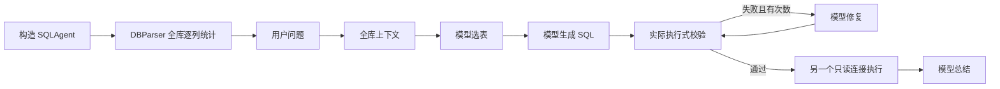
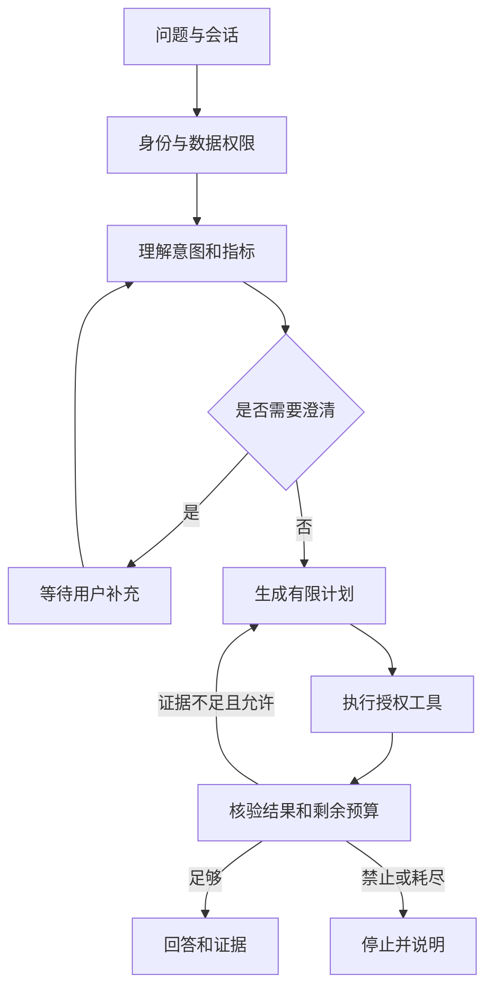

# DataAgent 项目设计文档

版本：V1.0｜日期：2026-10-22｜状态：基于现有代码的建设方案，尚未实施

配套文档：[功能设计文档](功能设计文档.md)、[技术设计文档](技术设计文档.md)。本文回答“为什么建设、建设到什么程度、如何分期和验收”。

## 1. 项目结论

现有项目是具备有限纠错能力的 SQLite Text-to-SQL 原型：能够根据自然语言选择数据表、生成 SQL、遇到校验错误时修复、执行查询并生成中文答案。它已包含 Agent 的工具使用和反馈修复雏形，但主流程仍固定，尚不能根据问题歧义、查询结果或任务状态自主选择澄清、补查、停止等动作。

建议建设为**受权限、工具和预算约束的数据分析 Agent**：用户提出数据问题后，系统先确认口径，在授权数据范围内制定计划并查询，根据结果决定是否有限补查，最后给出有查询证据和限制说明的结论。

首要工作是修复执行安全边界，再实现闭环决策。引入某个 Agent 框架、多模型、多 Agent 或向量数据库，都不是本项目成为 Agent 的必要条件。

## 2. 分析依据与边界

### 2.1 本次实际检查范围

当前 `dataagent` 目录中原有文件只有 `sql_agent.py` 和 `db_parser.py`。未发现本项目的入口脚本、README、依赖清单、数据库文件、Web/API 服务、测试、部署配置或独立业务说明；不据此推断其他目录也没有这些内容。

以下定位均针对本次分析时的源文件；后续修改代码后行号可能变化。

| 代码位置 | 实际职责 |
| --- | --- |
| `sql_agent.py:14`，`SQLAgent.__init__` | 初始化模型客户端、数据库路径、重试次数和返回行数；构造 DBParser |
| `sql_agent.py:33`，`_ask_deepseek` | 通过兼容客户端向固定服务地址与模型名称发请求 |
| `sql_agent.py:58`，`get_schema_context` | 组织全部表字段、样例和外键上下文 |
| `sql_agent.py:81`，`select_tables` | 模型选表，JSON 解析后匹配真实表名 |
| `sql_agent.py:143`，`generate_sql` | 基于选表和上下文生成 SQLite 查询 |
| `sql_agent.py:177`，`validate_sql` | 正则入口检查，随后调用实际执行式校验 |
| `sql_agent.py:202`，`rewrite_sql` | 基于错误信息重新生成 SQL |
| `sql_agent.py:237`，`execute_sql` | 通过只读 URI 执行，取至多 50 行 |
| `sql_agent.py:260`，`summarize` | 使用问题、SQL、结果生成中文回答 |
| `sql_agent.py:289`，`run` | 串行编排全部步骤，最多两次 SQL 修复，打印进度 |
| `db_parser.py:7`，`DBParser.__init__` | 反射表与外键；逐列统计去重、缺失、极值和样例 |
| `db_parser.py:116`，`check_sql` | 在持有的普通 SQLAlchemy 连接上执行待校验 SQL |

### 2.2 证据等级

- **代码事实**：直接由两份源码确认。
- **离线复现**：用临时 SQLite 数据库调用原类的方法验证，不访问真实业务数据库、不调用模型。
- **拟建方案**：本文及配套文档提出的能力、接口、阈值和排期，不代表已实现。
- **待确认假设**：未提供行业、用户规模和部署约束，先按内部、小规模、只读分析场景设计。

离线环境为 Python 3.13.9、SQLAlchemy 2.0.43、pandas 2.3.3、SQLite 3.51.0。当前 Python 环境未安装 `openai`，本目录也没有默认的 `chinook.db`。因此未运行完整 `SQLAgent.run()`，未验证真实模型名称可用性、业务结果准确率或线上性能。脚本通过 AST 装载原类以绕过未安装的客户端导入，测试结论仅覆盖被调用的方法。

复核材料：[验证脚本](evidence/verify_current_code.py)、[9 项行为观察结果](evidence/current_code_observations.json)。脚本断言的是当前行为，包含缺陷复现；“9 项通过”不表示项目质量验收通过。

## 3. 现状流程与主要问题

特别注意：全库统计发生在对象初始化期间，而不是等用户问题到达后才按需执行。`get_schema_context()` 每次运行重新整理全部表信息，但其中统计和样例来自初始化缓存，不保证反映当前数据。

### 3.1 必须先解决的风险

| 编号 | 问题与证据 | 影响 | 处理顺序 |
| --- | --- | --- | --- |
| R01 | `validate_sql` 接受 `WITH` 开头；`check_sql` 直接使用非只读连接执行。离线 `WITH ... UPDATE` 被放行并改变连接内可见数据 | 校验阶段可能产生写入副作用；不能把末端只读连接视为全链路保护 | P0，服务化前 |
| R02 | `validate_sql(tables)` 未使用表范围；`execute_sql` 的 `allowed` 变量未参与授权。离线可读未选表 | “选表”提示不构成权限控制；接入敏感数据后可越界读取 | P0，服务化前 |
| R03 | 字段统计含原值、极值、众数、样例；全库字段被送入选表提示 | 敏感数据可能在查询前进入外部模型上下文 | P0，真实数据接入前 |
| R04 | 未设置应用级 SQL 截止时间、操作数或进程资源预算；查询可能在校验和执行阶段各运行一次 | 重查询、递归查询或高代价 JOIN 可拖住服务 | P0 |
| R05 | 空文本表的众数查询 `fetchone()[0]` 在离线复现中触发 TypeError | 数据源接入失败；空表处理不健壮 | P0 |
| R06 | `len(rows) >= 50` 判断截断，离线恰好 50 行也被标记截断 | 答案可能错误提示还有更多结果；无法区分业务 LIMIT 与系统截断 | P0 |
| R07 | 字符串中分号被当作多语句，离线 `SELECT ';'` 被拒 | 合法查询误判；正则不适合承担完整 SQL 解析 | P0 |
| R08 | 只在校验失败时修复；执行、选表格式、总结异常直接抛出 | 缺少分阶段恢复、失败结果和保留证据的降级输出 | P0 |
| R09 | 没有会话、业务词典、明确指标口径和结果核验 | SQL 能执行不等于问题被正确回答 | P0/P1 |
| R10 | 普通连接长期保存；缺少关闭接口。SQLite `with` 事务上下文也不是显式关闭连接 | 长时间运行时连接、锁和资源生命周期难管理 | P0 |

R01 的复现证据只证明校验已执行写语句且修改在该连接可见；本次未断言业务数据被永久提交。事务配置可能影响持久化结果，设计上必须在执行前拒绝此类语句。

### 3.2 能力盘点

| 能力 | 当前状态 | 建设目标 | 版本 |
| --- | --- | --- | --- |
| 自然语言转 SQL | 已有提示式实现，未有准确率基线 | 输出结构化查询规格和参数，执行前检查 | MVP |
| Schema 感知 | 已有表、字段、外键和逐列统计 | 授权范围内发现结构，按需取最小上下文 | MVP |
| 表选择 | 已过滤不存在的表名 | 相关表选择与访问权限分开；支持关联路径补齐 | MVP |
| 工具调用 | 直接调用 Python 方法 | 有输入输出约束、授权和超时的工具注册表 | MVP |
| 规划与动作选择 | 固定串行流程 | 可选择澄清、查询、补查、答复或终止 | MVP |
| 自我纠错 | 仅校验失败后最多两次修复 | 区分语法、结构变化、瞬时故障和禁止行为 | MVP |
| 结果核验 | 仅总结提示约束 | 核验时间、口径、粒度、空值和截断，必要时补查 | MVP |
| 会话记忆 | 无 | 保存已确认筛选和口径，支持追问和清除 | MVP |
| 可追溯输出 | 返回 SQL、表和内存 history | 保存实际执行 SQL、参数、结果引用、版本与时间 | MVP |
| 数据安全 | 最终执行连接只读，其他路径有缺口 | 全路径只读、表列权限、脱敏、外发策略和预算 | MVP |
| 多步骤对比、趋势 | 可能偶然生成复杂 SQL，无任务能力保证 | 有限步骤计划及多证据结论 | MVP 基础 / P1 完整 |
| 图表与导出 | 无 | 基于已授权结果生成图表和受控导出 | P1 |
| 多数据库 | DBParser 有数据库类型判断，但 Agent 绑定 SQLite | 通过方言和授权适配器逐项验收后支持 | P2 |
| 运行与评测 | 只有控制台日志 | 任务状态、结构化观测、回归样例、部署配置 | MVP |

## 4. 产品定位与目标用户

### 4.1 目标用户

| 角色 | 核心诉求 |
| --- | --- |
| 业务分析用户 | 不写 SQL 也能查询；理解指标、时间范围和结果限制 |
| 数据分析师 | 复核 SQL、参数、关联关系，验证统计口径与结论 |
| 数据管理员 | 配置数据源、可用表列、业务词典、外发策略和数据版本 |
| 运维维护者 | 查看阶段耗时和失败原因，控制成本、取消任务、回放故障 |

MVP 先按单组织内部部署设计。即使只有一个组织，也要有身份校验和数据源授权；不把公网匿名访问当作默认场景。

### 4.2 核心场景

1. 基础问数：“按国家统计指定年度的销售额，列出前十名。”
2. 口径澄清：“最好的客户是谁？”系统确认按消费额、订单数还是其他指标排名。
3. 多轮分析：“只看某个国家，再与上一年相比。”继承已确认指标，并更新筛选条件。
4. 结果探索：“为什么同比下降？”先做可验证的分组贡献分析；解释为数据变化线索，不将相关性写成因果结论。
5. 数据不可答：“预测明年的利润。”当前数据和工具无法支持时明确说明缺口，不编造答案。

以上为设计示例，不表示本目录已经包含客户、销售额或利润数据。

### 4.3 项目成功标准

用户能完成“提出问题 → 必要澄清 → 看见计划与进度 → 获取可复核答案 → 继续追问”的闭环；系统在不确定、无权限或达到预算时能够停止，并保留已完成步骤和证据。

## 5. 目标范围

### 5.1 MVP 必须交付

- 单个启用的 SQLite 业务数据源；管理员可注册路径与权限，普通用户只选择数据源 ID。
- 自然语言查询、会话追问、必要口径澄清、有限步骤分析及两次以内 SQL 修复。
- 授权 Schema 检索、受控 SQL 工具、业务词典、结果核验和证据化回答。
- 任务创建、状态查询、补充输入、取消、结果查看；先提供 CLI/API，界面可后续增加。
- 所有业务数据访问路径只读；表列授权、脱敏、模型外发开关、查询与模型预算。
- 持久化任务和脱敏审计；失败可定位、总结失败时可展示查询结果。
- 可重复运行的评测集、依赖声明、环境变量模板、安装运行说明。

### 5.2 后续能力

P1：更完整的多查询对比与趋势、图表、受控 CSV 导出、更完善的语义检索与反馈。

P2：第二种数据库方言、多人组织与更细权限、异步队列及规模化部署；如确有必要再接入向量检索或独立编排框架。

### 5.3 当前排除范围

业务库写入、自动修改数据或表结构、任意 Python/Shell 执行、任意文件访问、无限自主探索、跨源联邦查询、训练自有大模型、自动发布报表和外部发送通知，均不属于本次 MVP。

## 6. Agent 设计原则

### 6.1 从固定链路升级为受控闭环

模型负责理解问题、提出动作和组织解释；程序负责身份、权限、状态、参数校验、工具选择范围、执行与停止。模型不能扩大自己的表列范围、修改安全配置或绕过预算。

### 6.2 最小有效架构

采用一个编排器管理任务状态，由结构化动作驱动工具调用。先用显式状态机实现有限闭环，减少迁移成本，便于回放和验证。不是让模型自由拼装工具名称或直接执行任何返回文本。

“记忆”先保存可审计的会话事实，例如已确认指标、日期范围和结果引用；不将历史长对话或用户指令直接视为永久规则。

## 7. 建设阶段与交付物

以下是工作量参考，假设一名熟悉 Python 的开发者、一个可用测试库、稳定的模型访问条件；不是已确认排期。真实数据授权、评测标注和基础设施采购不包含在估算中。

| 阶段 | 参考开发工作量 | 工作内容 | 退出条件 |
| --- | --- | --- | --- |
| M0：安全与可运行基线 | 3–5 人日 | 依赖与入口、统一只读连接、去除执行式校验、表列授权、空表和截断修复、离线安全回归 | 禁止语句与越权测试全部阻断；无需模型即可运行夹具测试 |
| M1：单问题 Agent | 5–7 人日 | 工具协议、状态机、口径澄清、受限计划、核验与证据输出、任务持久化和 CLI/API | 单轮任务可查询、澄清、失败和取消；证据齐全 |
| M2：会话与交付验收 | 3–5 人日 | 多轮继承、有限补查、错误分类、预算与降级、评测和部署文档 | 达到 MVP 验收门槛，完成独立部署演练 |
| M3：体验扩展 | 另行估算 | 图表、导出、业务界面与检索优化 | 分项评测和权限验收 |

M0–M2 合计约 11–17 人日，需在实际库规模、并发需求和标注样例确定后重新估算。先把 M0 做成可运行基线，避免在不可靠的查询执行层上扩展交互能力。

## 8. MVP 验收与度量

以下均为拟定门槛，不是当前测试结果。详细用例见功能文档；实现方法见技术文档。

| 维度 | 拟定验收门槛 | 统计方式 |
| --- | --- | --- |
| 安全 | 固定攻击/越权回归用例全部阻断 | 同时覆盖校验、Schema、正式执行、补查与总结外发；不能只测最终连接 |
| 结果正确性 | 40 个具有确定答案的基础查询至少 36 个正确 | 比较结果集合/数值及业务口径，不要求 SQL 文本完全一致 |
| 歧义处理 | 10 个必须澄清的样例全部进入等待输入 | 检查澄清项是否针对真正缺失口径 |
| 证据完整 | 所有成功任务都有 SQL、参数、数据源、查询时间和结果引用 | 结构化字段完整率 100% |
| 安全停止 | 超预算、查询超时、权限失败均有明确终态 | 不无限修复；取消后不产生新工具调用 |
| 稳定性 | 空表、无结果、模型格式错误、外部故障均有可理解输出 | 无结果不能自动解释为零；总结失败保留查询证据 |
| 性能 | 指定环境下单任务热启动 P95 目标不超过 30 秒 | 10 张表、总计约 10 万行、并发 1、至少 30 次有效请求；另报冷启动、LLM、SQL 耗时 |
| 资源 | 默认单任务最多 8 次模型请求、12 次工具调用、3 次正式查询 | 包括失败调用与传输重试，持久化记录并执行限额 |

模型延迟和数据分布会影响性能目标；必须记录模型配置、数据库快照和硬件，不能把该目标作为当前性能承诺。固定安全用例全部通过也不等于覆盖所有攻击，应随缺陷增加回归集。

## 9. 主要风险与决策记录

| 风险或待定项 | 本版默认决策 | 后续确认方式 |
| --- | --- | --- |
| 数据行业与指标不明确 | 使用通用分析域，不虚构销售等实际业务字段 | 管理员提供字段说明和 20 条代表性问题 |
| 数据外发范围未知 | 样例与行级原值默认不外发；优先聚合、脱敏或模板回答 | 数据管理员批准数据源的模型外发策略 |
| 模型服务与名称可用性未知 | 通过配置和启动探测验证；不以源码常量视为可用性保证 | 凭据就绪后做少量真实联调 |
| 多数据库诉求不明确 | SQLite 先闭环；其他方言必须单独测试 | 确认第二种数据库、驱动与权限方案 |
| 身份系统未提供 | 内部单组织、管理员配置的用户令牌；授权逻辑保留可替换接口 | 对接实际登录系统前复核部署方式 |
| 历史库日期与当前日期不一致 | 相对日期不足以定位数据时明确澄清；不悄悄改成年份 | 展示数据时间覆盖范围并记录用户选择 |
| 同时修改代码与数据结构 | 保存 schema_version、policy_version 与指标版本 | 任务继续前重验权限和结构；变化时重新规划 |

## 10. 文档之间的对应关系

| 本文规划 | 功能文档 | 技术文档 |
| --- | --- | --- |
| 数据接入与语义 | F01–F03 | 数据连接、Schema 服务与语义配置 |
| 受控 Agent 闭环 | F04–F08 | 状态机、工具协议、执行与核验 |
| 答复与多轮分析 | F09–F10 | 证据对象、会话事实与结果持久化 |
| 可用服务与治理 | F11–F13 | API、权限、预算、日志、部署与评测 |

设计依据中的第三方机制由官方资料核对：SQLite URI 的 `mode=ro` 用于只读打开；连接授权回调用于限制编译期操作。具体落地及其局限见[技术设计文档的参考资料](技术设计文档.md#15-参考资料)。
