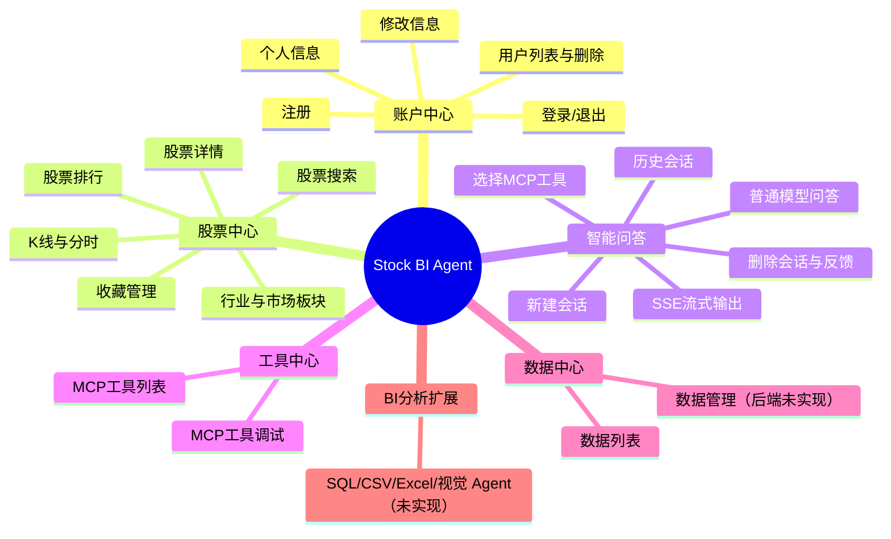
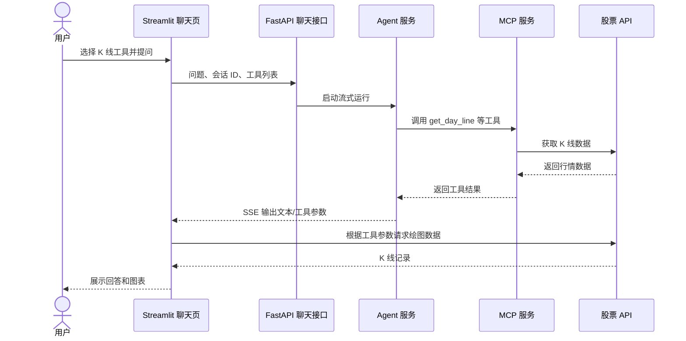

# 功能设计文档

## 1. 文档说明

本文按用户可见能力说明页面、功能规则、主要流程和接口。当前项目是教学型原型；对于代码中的空路由、占位 Agent 和尚未实现的安全能力，均标明为“未实现”或“需补齐”。

## 2. 功能结构

## 3. 功能说明

### 3.1 账户中心

| 功能 | 用户操作 | 当前规则/行为 | 相关接口 |
|---|---|---|---|
| 注册 | 提交用户名、密码、角色 | 同名用户返回失败；密码保存为 SHA-256 哈希 | `POST /v1/users/register` |
| 登录 | 提交用户名和密码 | 对比用户名和密码哈希；响应成功后由前端维护登录状态 | `POST /v1/users/login` |
| 查询个人信息 | 输入用户名 | 返回用户 ID、用户名、角色、注册时间和状态 | `POST /v1/users/info` |
| 修改用户信息 | 提交用户名、角色或状态 | 路由调用服务修改字段；当前未形成可靠的管理员授权边界 | `POST /v1/users/reset-info` |
| 修改密码 | 提交旧密码和新密码 | 先校验旧密码，再更新哈希 | `POST /v1/users/reset-password` |
| 用户列表 | 请求列表 | 默认最多读取 200 条 | `POST /v1/users/list` |
| 删除用户 | 提交用户名 | 删除该用户记录 | `POST /v1/users/delete` |

### 3.2 股票中心

股票数据通过 `api/autostock.py` 访问外部股票服务。主要能力包括股票代码模糊搜索、指数代码、行业/市场板块、排行、股票基本信息、日/周/月 K 线和分时数据。HTTP 子应用挂载在 `/stock` 下；对应操作也会被 MCP 聚合服务导入。

收藏功能由项目自己的业务数据库提供：

| 功能 | 接口 |
|---|---|
| 查询用户收藏 | `POST /v1/stock/list_fav_stock?user_name=...` |
| 添加收藏 | `POST /v1/stock/add_fav_stock?user_name=...&stock_code=...` |
| 删除收藏 | `POST /v1/stock/del_fav_stock?user_name=...&stock_code=...` |
| 清空收藏 | `POST /v1/stock/clear_fav_stock?user_name=...` |

### 3.3 智能问答

#### 新建与持续对话

1. 前端请求 `POST /v1/chat/init` 获取随机会话 ID。
2. 用户提交问题、用户名、会话 ID、可选任务和工具列表到 `POST /v1/chat/`。
3. 新会话首次聊天时创建会话记录；服务层保存用户消息并调用 Agent。
4. Agent 的文本增量通过 SSE 返回，前端实时展示。
5. 助手回答及工具调用信息写入业务消息表；Agent SDK 同时维护独立会话记忆。

聊天请求体由 `RequestForChat` 定义，主要字段：

| 字段 | 类型 | 用途 |
|---|---|---|
| `content` | string | 用户问题，必填 |
| `user_name` | string | 会话归属用户名，必填 |
| `session_id` | string 或 null | 恢复已有上下文；未提供时由前端先初始化 |
| `task` | string 或 null | 任务模式，如“股票分析”或“数据BI” |
| `tools` | string 列表或 null | 允许 Agent 使用的 MCP 工具 |
| `image_content`、`file_content` 等 | string 或 null | 预留多模态/文件输入字段，当前聊天链路未完整处理 |

任务模式会影响系统提示词。没有选择工具时，当前逻辑直接请求模型；选择工具时，Agent 连接 MCP 服务并限制可用工具。对股票 K 线工具，前端会解析模型输出的工具名和参数，再取数绘图。

#### 会话管理

| 功能 | 接口 | 说明 |
|---|---|---|
| 获取会话消息 | `POST /v1/chat/get?session_id=...` | 返回会话消息及反馈字段 |
| 查询用户会话列表 | `POST /v1/chat/list?user_name=...` | 返回会话标题、ID、开始时间 |
| 删除会话 | `POST /v1/chat/delete?session_id=...` | 删除会话及关联消息 |
| 消息反馈 | `POST /v1/chat/feedback?...` | 记录消息反馈及时间 |

### 3.4 MCP 工具中心

聊天页从 MCP 服务读取工具列表，用户通过多选框决定本次聊天可用工具。当前工具域包括：

- **股票工具**：股票搜索、排行、基础信息、K 线、分时、指数和市场信息。
- **新闻工具**：日报、热点及新闻类数据。
- **通用工具**：天气、地址解析、电话归属、景点、花语和汇率。
- **语录工具**：名言和激励语录。

工具列表与工具调用依赖 MCP 服务运行及外部 API 可访问。工具失败时当前部分封装返回空列表或空对象，前端不一定能区分“无数据”和“上游异常”。

### 3.5 数据中心与 BI 分析

界面中有数据列表和数据管理页面，ORM 中也存在 `data` 元数据表；但 `/v1/data/download`、`create`、`upload` 和 `delete` 当前均为空实现。CSV、Excel、数据库查询 Agent 也尚未完成。因此上传、数据目录、自然语言转 SQL、代码执行和图表生成不属于当前可用功能。

## 4. 主要业务流程

### 股票 K 线问答

## 5. 通用响应与异常表现

常规业务路由大多使用 `BasicResponse`，包含 `code`、`message`、`data`。聊天主接口则以 `text/event-stream` 返回增量内容。当前错误处理主要采用捕获异常并返回错误信息或空数据；后续应统一错误码、日志关联 ID、用户可见提示和上游服务错误分类。

## 6. 功能验收要点

- 登录后能够发起普通聊天，并看到逐段输出。
- 选择 MCP 工具后，Agent 可用工具范围受到所选工具限制。
- 会话刷新或重新进入后，可以从业务数据库恢复显示的消息记录。
- 用户可以查看并删除自己的会话，添加、删除和查看收藏股票。
- K 线工具调用后，页面能基于解析出的股票代码和周期展示对应图表。
- 未实现的数据上传和 BI 分析能力应在界面或文档中明确标为规划中，不能显示成已成功处理。

