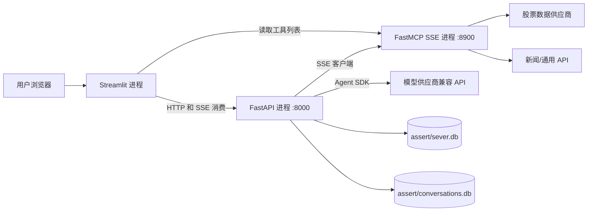

# 技术设计文档

## 1. 文档说明

本文描述当前实现的进程结构、模块边界、接口、数据模型、聊天与 MCP 调用、配置和运行方式。涉及未来 SQL/代码执行、数据集管理等能力时，作为扩展设计说明，不代表已经上线。

## 2. 技术栈

| 类别 | 技术 | 用途 |
|---|---|---|
| Web API | FastAPI、Uvicorn | REST 风格业务接口与股票 API 子应用 |
| 前端 | Streamlit | 多页交互、聊天、表格和图表 |
| Agent | OpenAI Agents SDK | Agent、流式运行、工具调用和会话记忆 |
| MCP | FastMCP | 聚合 FastAPI 工具和 Python MCP 工具，以 SSE 提供服务 |
| 模型客户端 | OpenAI Python SDK | 通过兼容接口连接配置的大模型供应商 |
| 数据访问 | SQLAlchemy 2、SQLite | ORM、业务表和本地持久化 |
| 数据与图表 | Pandas、NumPy、Plotly | K 线数据整理和可视化 |
| 模板 | Jinja2 | 生成带任务上下文的系统提示词 |

依赖版本以 `requirements.txt` 为准。

## 3. 部署拓扑与进程



当前默认服务地址：

- FastAPI：`0.0.0.0:8000`
- MCP SSE：`localhost:8900`；聊天服务配置的 SSE URL 为 `http://localhost:8900/sse`
- Streamlit：通过本机 HTTP 地址调用后端；常见启动方式会使用 Streamlit 默认端口。

开发启动可从项目目录执行：

```powershell
python main_server.py
python main_mcp.py
streamlit run demo/streamlit_demo.py
```

三条命令应在各自终端或进程管理器中运行。因为数据库与模板采用相对路径，工作目录应为 `06-stock-bi-agent`。

## 4. 模块设计

### 4.1 业务 API

`main_server.py` 创建主 FastAPI 应用并注册 `routers.user`、`routers.chat`、`routers.data` 和 `routers.stock`，再通过 `app.mount("/stock", stock_app)` 挂载股票 API 子应用。

业务接口前缀：

| 前缀 | 路由职责 |
|---|---|
| `/v1/users` | 用户账户及信息管理 |
| `/v1/chat` | 聊天、历史会话、删除和反馈 |
| `/v1/stock` | 用户收藏股票管理 |
| `/v1/data` | 数据管理占位接口 |
| `/stock` | 股票数据查询子应用 |

### 4.2 服务层

- `services/chat.py`：提示词渲染、会话初始化、Agent 创建、工具过滤、流事件处理及聊天记录访问。
- `services/user.py`：用户注册、登录、密码重置、用户资料与状态管理。
- `services/stock.py`：收藏股票增删查。

路由尽量只做参数接收和响应包装；服务层组织业务步骤并访问 ORM 或 Agent SDK。

### 4.3 MCP 工具注册

`main_mcp.py` 以 `FastMCP.from_fastapi(app=api.autostock.app)` 将股票 FastAPI 操作转换为 MCP 工具，再导入新闻、语录和通用工具服务器。`operation_id` 为股票工具提供稳定名称，例如 `get_stock_info`、`get_day_line`、`get_stock_minute_data`。

聊天服务通过 Agents SDK 的 `MCPServerSse` 连接 MCP 地址；若请求提供工具名列表，就使用 `ToolFilterStatic(allowed_tool_names=tools)` 控制本轮工具集合。工具串行配置为 `parallel_tool_calls=False`。

对 `get_month_line`、`get_week_line`、`get_day_line` 和 `get_stock_minute_data`，聊天服务选择 `stop_on_first_tool` 一类策略以便前端获取工具调用信息并触发可视化；其他工具通常由 Agent 在工具结果后继续生成回答。

### 4.4 模型与提示词

聊天服务读取模型名、API Key 和兼容 API Base URL 来创建 `AsyncOpenAI` 客户端，再用 `OpenAIChatCompletionsModel` 交给 Agents SDK。任务提示词由 `get_init_message()` 选择股票分析、数据 BI 或普通聊天说明，并渲染 `templates/chat_start_system_prompt.jinjia2`。

当前 `main_server.py` 在模块加载时直接给模型配置赋值。部署设计应改成从运行环境读取必需配置，启动时校验缺失项，并确保凭据不写入代码仓库、日志或前端。

### 4.5 流式输出

聊天接口返回 `StreamingResponse`，媒体类型为 `text/event-stream`。服务层迭代 Agents SDK 的流事件，将 `ResponseTextDeltaEvent` 的文本片段通过异步生成器交给 FastAPI；前端使用 `requests` 的流式响应逐块更新消息。

当前流输出是文本增量，不是统一的结构化事件协议。工具调用名和参数也以 Markdown JSON 代码块形式呈现，因此前端需要解析文本。后续如扩展工具状态、引用来源或图表，应定义带事件类型的协议，避免把模型展示文本同时当成机器接口。

## 5. 接口设计

### 5.1 聊天接口

| 方法与路径 | 输入 | 输出 |
|---|---|---|
| `POST /v1/chat/init` | 无 | `BasicResponse`，`data.session_id` |
| `POST /v1/chat/` | JSON `RequestForChat` | `text/event-stream` 文本增量 |
| `POST /v1/chat/get?session_id=...` | 会话 ID | 消息数组 |
| `POST /v1/chat/list?user_name=...` | 用户名 | 会话摘要数组 |
| `POST /v1/chat/delete?session_id=...` | 会话 ID | 基础响应 |
| `POST /v1/chat/feedback` | 会话 ID、消息 ID、反馈值 | 基础响应 |

`RequestForChat` 还预留了图像、文件、URL、音频、视频和模式开关字段；当前聊天服务主要使用文本、任务、会话 ID 和工具列表。

### 5.2 股票数据接口

股票子应用提供以下工具/HTTP 操作：

| 路径 | 用途 | 关键参数 |
|---|---|---|
| `/stock/get_stock_code` | 股票代码和名称模糊搜索 | `keyword` |
| `/stock/get_index_code` | 指数代码列表 | 无 |
| `/stock/get_industry_code` | 行业/板块数据 | 无 |
| `/stock/get_board_info` | 市场大盘信息 | 无 |
| `/stock/get_stock_rank` | 股票排行 | `node`、行业、分页、排序 |
| `/stock/get_month_line` | 月 K 线 | `code`、日期范围、复权类型 |
| `/stock/get_week_line` | 周 K 线 | `code`、日期范围、复权类型 |
| `/stock/get_day_line` | 日 K 线 | `code`、日期范围、复权类型 |
| `/stock/get_stock_info` | 股票基本信息 | `code` |
| `/stock/get_stock_minute_data` | 当日分时数据 | `code` |

以上函数由 `api/autostock.py` 实现，并通过请求第三方股票数据服务获取结果。外部供应商凭据当前配置在源码中，应改由安全配置注入。

## 6. 数据模型与持久化

业务数据库模型定义于 `models/orm.py`：

| 表 | 关键字段/用途 |
|---|---|
| `user` | 用户名、角色、密码哈希、注册时间、状态 |
| `data` | 文件路径、数据类型、创建人及时间；尚未接入完整业务流 |
| `user_favorite_stock` | 用户 ID、股票代码、创建时间 |
| `chat_session` | 用户 ID、公开会话 ID、标题、创建时间和反馈 |
| `chat_message` | 会话 ID、角色、文本内容、SQL/代码预留字段、反馈 |

业务数据库 URL 为相对路径 `sqlite:///./assert/sever.db`。SQLAlchemy 模型导入时调用 `Base.metadata.create_all()`，用于创建缺失表；这不是版本化数据库迁移机制。

Agents SDK 的 `AdvancedSQLiteSession` 使用 `./assert/conversations.db`。业务消息库中保存页面历史，Agent 会话库中保存模型上下文，两者的记录内容和生命周期不应混为一谈。

## 7. 配置管理

当前需要配置的关键项包括：

| 配置 | 用途 | 建议管理方式 |
|---|---|---|
| 模型 API Key | 模型服务鉴权 | 环境变量或密钥管理服务 |
| 模型 Base URL | 兼容 API 服务地址 | 环境变量 |
| 模型名称 | 选择文本模型 | 环境变量/部署配置 |
| 视觉模型名称 | 预留视觉模式 | 环境变量；功能实现后再启用 |
| 股票/新闻 API Token | 外部数据服务鉴权 | 环境变量或密钥管理服务 |
| MCP SSE URL | Agent 连接工具服务 | 环境变量或部署配置 |
| SQLite 文件路径 | 业务库和会话库位置 | 环境变量或配置文件 |

当前代码将部分模型和第三方 API 凭据硬编码在源码中。不要将真实凭据复制到文档或提交记录；迁移配置时应轮换已暴露的凭据。

## 8. 错误处理与可观测性

当前外部 API 封装普遍捕获异常并返回空对象/数组，路由层也有宽泛异常捕获。建议后续统一：

- 参数错误、业务冲突、未授权、上游超时和上游错误的分类。
- 面向客户端的稳定错误码与不泄漏内部堆栈的消息。
- 请求 ID、会话 ID、工具名、外部调用耗时和结果状态日志。
- SSE 断连后的任务取消、超时和资源清理。
- 外部 API 的限速、有限重试、熔断和响应校验。

## 9. 安全与可靠性设计约束

- 为用户接口引入真正的认证凭证及路由级授权；不能仅依赖客户端传入的 `user_name`。
- 密码应使用专用慢哈希算法并加入随机盐，不使用普通 SHA-256 作为密码存储方案。
- 对上传文件校验大小、类型和内容，路径采用服务端生成值并限制访问范围。
- SQL/代码 Agent 必须运行在隔离沙箱，限制文件系统、网络、CPU、内存、执行时长和数据库权限。
- 仅通过 allowlist 注册工具；对模型生成的参数进行服务端校验，并记录调用审计信息。
- 多实例部署时迁移 SQLite 本地文件依赖，使用共享数据库和集中会话存储，并定义备份恢复策略。

## 10. 启动和开发验证

从 `06-stock-bi-agent` 目录安装 `requirements.txt` 中依赖后，可分别运行：

```powershell
python main_server.py
python main_mcp.py
streamlit run demo/streamlit_demo.py
```

业务 API 的 OpenAPI 页面通常位于 `/docs`；股票子应用挂载在 `/stock`，其文档由 FastAPI 子应用提供。运行前需配置有效的模型及外部服务凭据，并确保 MCP SSE 地址与聊天服务配置一致。

## 11. 后续技术演进建议

1. 把硬编码配置迁移到配置模块与环境变量，明确开发、测试和部署环境。
2. 统一 API 错误响应、日志、认证授权和数据库迁移。
3. 定义 SSE 结构化事件格式，使文本、工具调用、工具结果、图表数据和错误分别表达。
4. 完成数据集元数据与文件存储生命周期，再设计数据权限和删除策略。
5. 在安全沙箱与审计基础上实现 SQL、CSV、Excel 分析 Agent。
6. 增加健康检查、依赖服务状态检查、备份恢复和多实例部署方案。

