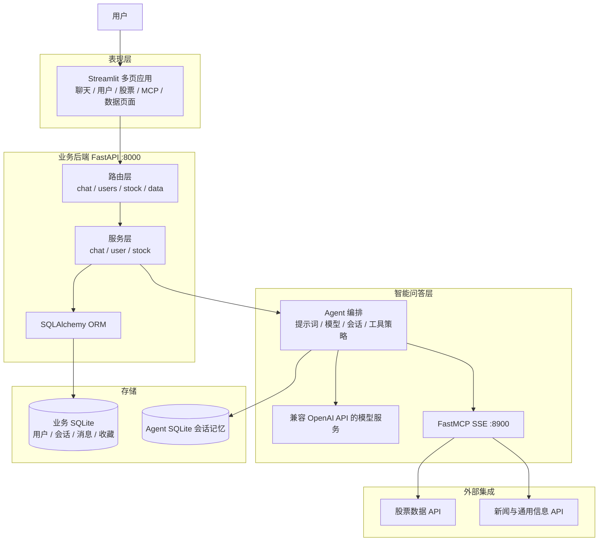

# 项目设计文档

## 1. 文档说明

本文根据当前仓库代码整理系统目标、范围、参与角色、逻辑架构、部署关系和演进边界。文中用“已实现”表示代码中存在对应实现；用“规划/占位”表示目录、模型或文档提及了该能力，但当前尚未形成完整业务闭环。

## 2. 项目概述

项目面向希望通过自然语言查询股票信息并开展初步分析的用户，提供一个分布式部署的股票问答助手。用户可通过 Streamlit 界面使用普通大模型聊天，也可以选择 MCP 工具查询股票、新闻及其他外部信息。系统支持多轮对话、历史会话查看和股票收藏。

项目名称中包含 ChatBI，README 也提出用户数据分析目标；但当前数据上传、SQL/CSV/Excel 分析等能力仍属于后续扩展，不能视为现有交付功能。

## 3. 建设目标与范围

### 3.1 当前目标

- 以 Web 界面提供聊天、股票查询和基础账户功能。
- 将模型调用与外部数据工具分开，通过 MCP 提供可发现、可筛选的工具能力。
- 支持多轮对话、会话列表、历史消息读取和简单反馈记录。
- 将用户业务数据和 Agent 会话状态分别持久化。

### 3.2 当前范围

| 能力域 | 当前状态 | 主要实现位置 |
|---|---|---|
| 用户注册、登录、信息管理 | 已实现基础流程 | `routers/user.py`、`services/user.py` |
| 股票查询工具 | 已实现外部 API 封装 | `api/autostock.py` |
| 收藏股票 | 已实现基础增删查 | `routers/stock.py`、`services/stock.py` |
| 多轮聊天和流式回答 | 已实现 | `routers/chat.py`、`services/chat.py` |
| MCP 工具聚合 | 已实现 | `main_mcp.py`、`api/news.py`、`api/saying.py`、`api/tool.py` |
| 对话历史和反馈 | 已实现基础存取 | `services/chat.py` |
| Streamlit 演示界面 | 已实现多页框架 | `demo/` |
| 数据集上传、管理及自然语言 BI | 规划/占位 | `routers/data.py`、`models/orm.py` |
| SQL、CSV、Excel、视觉分析 Agent | 规划/占位 | `agent/` |

### 3.3 非目标与边界

- 当前系统不是完整的投资决策或自动交易系统。
- 外部股票、新闻和通用信息由第三方服务提供，项目不负责其数据质量和可用性。
- 当前身份认证、权限管理和凭据管理属于教学实现，不能直接视为生产级安全方案。
- 尚未实现任意用户数据集的安全隔离、SQL 沙箱、代码沙箱和完整 BI 报表管理。

## 4. 用户与主要场景

### 普通用户

- 注册并登录演示系统。
- 查询股票信息、排行、市场板块和 K 线数据。
- 收藏或取消收藏股票。
- 创建聊天会话，选择可用工具并进行多轮问答。
- 查看、切换或删除历史会话。

### 管理/维护角色

代码包含用户列表、用户信息修改、删除等接口和页面。当前代码没有完整的角色授权机制，因此“管理角色”主要是页面与接口层面的功能示例，不应假定已经建立可靠的管理员权限边界。

## 5. 总体逻辑架构

## 6. 部署与运行单元

系统由三个可独立启动的进程构成：

1. **FastAPI 业务服务**：`main_server.py`，默认端口 `8000`，承载用户、聊天、收藏等 HTTP 接口，并在 `/stock` 下挂载股票 API 子应用。
2. **MCP 服务**：`main_mcp.py`，默认端口 `8900`，以 SSE 暴露股票和其他外部工具。
3. **Streamlit 前端**：`demo/streamlit_demo.py`，通过 HTTP 调用业务服务，并在聊天页连接 MCP 服务读取工具列表。

业务 SQLite 和 Agents SDK SQLite 当前均为本地文件。若部署为多实例，需重新设计共享数据库、会话记忆和文件存储，不能依赖各实例的本地磁盘状态。

## 7. 架构原则

- **职责分离**：页面负责交互，路由负责 HTTP 契约，服务层承载业务流程，Agent 编排模型和工具，API 适配器负责外部系统访问。
- **工具与模型解耦**：股票、新闻等数据工具通过 MCP 暴露，聊天 Agent 不直接依赖第三方 API 的具体实现。
- **状态分层**：业务记录和模型上下文分开存储，分别服务于应用查询和 Agent 多轮记忆。
- **渐进扩展**：新增数据源可实现成 API/MCP 工具；新增分析模式可扩充 Agent 编排和任务提示词。
- **能力可见**：设计和部署文档应明确区分已实现功能与占位功能。

## 8. 关键架构风险与后续决策

- 凭据目前写在源码中；部署前应迁移到环境变量或密钥管理服务，并轮换曾经提交过的凭据。
- 用户接口缺少完整的身份令牌、访问控制和角色校验方案。
- Agent 的 SQL/代码执行类扩展必须先设计沙箱、资源限制和数据权限。
- 外部 API 调用需要统一超时、错误分类、重试策略和可观测性。
- SSE 连接需要考虑断连、取消、超时和代理缓冲行为。
- SQLite 适合单机演示；生产部署需评估并发写入、备份、迁移及共享存储方案。

## 9. 主要代码索引

- 服务入口：`main_server.py`、`main_mcp.py`
- 接口层：`routers/`
- 业务层：`services/`
- 数据模型：`models/data_models.py`、`models/orm.py`
- Agent 与提示词：`services/chat.py`、`agent/`、`templates/`
- 外部工具：`api/`
- 用户界面：`demo/`
- 依赖清单：`requirements.txt`

