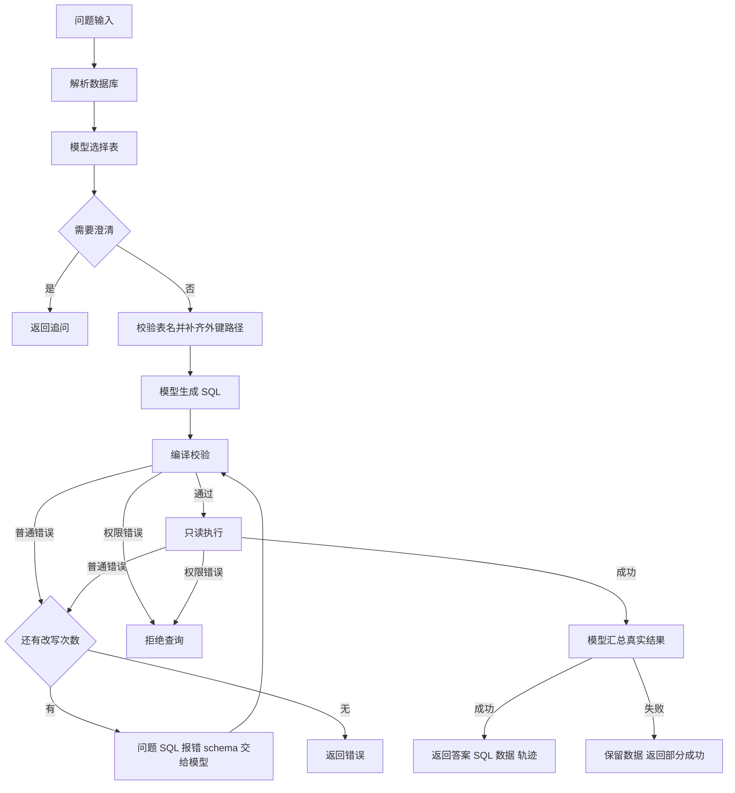

# Chinook SQL Agent 技术设计

系统以 Python 显式状态流编排模型调用，以 SQLite 自身完成 SQL 编译和权限判定。它保留课堂的七个步骤，同时避免通过实际执行 SQL 来做校验。

## 模块与依赖

| 模块 | 职责 |
| --- | --- |
| `main.py` | 参数、配置、离线案例、输出与退出码 |
| `database.py` | schema 解析、外键路径、只读连接、权限、预算、结果读取 |
| `llm.py` | 分阶段提示词、兼容 HTTP 客户端、JSON 解析、固定响应替身 |
| `sql_agent.py` | 七步编排、类型校验、改写预算、轨迹和结果状态 |
| `examples/cases.json` | 固定问题、表选择、SQL、可选改写与已知结果 |
| `tests/test_homework.py` | 真实数据库、错误恢复、访问权限和 HTTP 边界测试 |

运行仅需 Python 3.9+ 标准库。没有复用课堂示例中的凭据，也不依赖 Agents SDK。Notebook 导入相同模块，避免两份实现发生差异。

## 状态流



这里的多次模型调用是程序顺序编排的逻辑阶段，没有创建多个自治子代理或并行代理。

## 元数据与上下文

`Database.parse` 从 `sqlite_master` 读取业务表名，用 `PRAGMA table_info` 和 `foreign_key_list` 解析列与关系，统计行数，并读取发票日期上下界。不发送原始客户或员工样本。

选表模型看到业务描述、可读字段和发票日期范围。选表完成后仅提供相应表的完整结构。若模型选中关联的两端，按无向外键图进行广度优先搜索，补上最短路径中的连接表。它只提供可能的连接路径，不证明该路径必然符合用户意图。

## 模型协议

接口为 `POST {OPENAI_BASE_URL}/chat/completions`，使用 Bearer 认证和 `messages`。每次调用发送系统规则和本阶段 JSON 数据。响应读取 `choices[0].message.content`，拒绝模型拒答、截断和无效 JSON。最多读取 1MB 响应。

四种阶段的字段如下：

```text
select    -> tables: list[str], reason: str,
             needs_clarification: bool, clarification: str
generate  -> sql: str, explanation: str
rewrite   -> sql: str, explanation: str
summarize -> answer: str
```

本地逐字段检查，不把 JSON mode 当作 schema 保证。`OPENAI_JSON_MODE=true` 时额外发送 `response_format={"type":"json_object"}`。默认关闭以兼容不支持该选项的模型；不是所有标为兼容的服务都已验收。

客户端只允许远程 HTTPS 和本机 HTTP，拒绝重定向。临时 HTTP 错误与网络错误指数退避，最多三次；不在日志中复制供应商原始报错。接口格式参考 [OpenAI Chat Completions 文档](https://developers.openai.com/api/reference/resources/chat/subresources/completions/methods/create)，JSON 模式边界见[官方结构化输出说明](https://developers.openai.com/api/docs/guides/structured-outputs?api-mode=chat)。

## SQL 校验与执行

连接使用文件 URI 的 `mode=ro`，设置 `query_only=ON`、`trusted_schema=OFF`，每次查询独立关闭连接。权限回调默认拒绝，允许 SELECT、递归查询、所选业务表和函数白名单；拒绝写入、DDL、附加数据库、PRAGMA、系统表、未选表和受限列。

校验使用 `EXPLAIN QUERY PLAN`，不会运行原查询表达式。校验成功只说明当前阶段能够编译；某些函数解析或表达式错误仍可能延后到执行，所以执行层再次应用完全相同的权限，并处理运行错误。不能依靠 SQL 关键字正则来判断安全，字符串中的 `';DROP TABLE'` 可以作为普通文本，真正的多条 SQL 由 `execute` 拒绝。

权限回调处理参数为 `None` 的情况。`COUNT(*)` 等不读取具体列的查询可能传入空列名；仅在允许的业务表上接受这种读取。参考 [SQLite 权限回调规范](https://www.sqlite.org/c3ref/set_authorizer.html)。

进度回调每约 1000 条 VM 指令检查单次 SQL 的秒数和指令预算。Python 3.11+ 额外使用 `setlimit` 限制单个 SQLite 值大小。Python 3.9 的长表达式内存和进度回调的抢占精度有限；这不是面向任意恶意 SQL 的独立进程沙箱。生产版需要进程资源限制和数据库账号权限。

结果逐行读取，最多额外取一行判断是否截断。拒绝二进制值；数据值的文本合计上限为 64000 字节。SQL 编译和执行各自拥有预算，整次工作流还可能包含多次模型调用，因此 `--timeout` 不是请求总耗时上限。

## 改写与异常

SQL 语法、字段、普通函数或运行错误触发改写，携带原问题、原 SQL、真实错误、所选 schema 和函数白名单。默认两次 SQL 改写共享一个计数，改写后从编译开始。权限错误不允许修复后继续。

模型输出格式纠正每阶段最多一次，HTTP 重试在客户端内进行，两者与 SQL 改写预算分离。模型总结失败时返回 `partial` 和已成功的真实数据，不丢失结果，也不声称完整成功。

## 返回数据

```json
{
  "question": "全部发票的总销售额是多少？",
  "mode": "live",
  "status": "ok",
  "selected_tables": ["invoices"],
  "sql": "SELECT ROUND(SUM(Total), 2) AS revenue FROM invoices",
  "result": {
    "columns": ["revenue"],
    "rows": [[2328.6]],
    "returned_rows": 1,
    "truncated": false,
    "row_limit": 50
  },
  "answer": "全部发票销售额为 2328.60，币种未注明。",
  "rewrites": 1,
  "trace": [],
  "elapsed_ms": 0
}
```

以上为字段示意，耗时占位，`trace` 实际包含阶段事件；不是一次真实模型运行记录。离线结果明确使用 `mode=replay`。

## 验证与扩展

测试使用真实数据库和模拟模型响应，覆盖结果值、编译失败、运行失败、修复预算、函数与列权限、SQL 注入式访问、截断、空结果、配置和 HTTP 解析。测试前后比较数据库 SHA-256，确认受限查询未改写文件。

后续增加 Web、MCP 和其他数据库时，保留模型与执行器的边界。数据库用户权限应由身份决定，不能由模型自行选择；数据库适配器需要独立实现方言、校验、预算和授权，不能直接把 SQLite 的权限回调复制到 MySQL。多轮会话应保存经过验证的结构化过滤条件，不能依赖历史答案重新推断真实数据。
