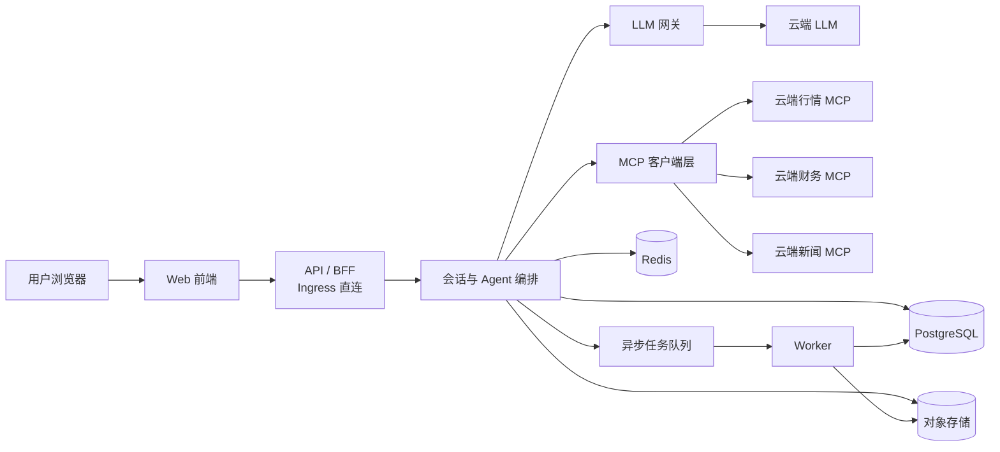

# 股票分析助手 · 项目设计文档

| 项 | 内容 |
| --- | --- |
| 文档版本 | v0.2（团队评审后修订稿） |
| 文档状态 | 待审计 |
| 编写日期 | 2026-10-22 |
| 需求依据 | 仓库根目录 README.md |
| 评审角色 | 产品负责人、架构师、前端/测试、安全合规 |
| 关联文档 | 02-功能设计文档、03-技术设计文档 |

> 本版已收敛 v0.1 的团队评审意见。文中量化目标为**设计建议值**，需审计确认；合规与数据授权项为 M0 准入门槛。

---

## 1. 背景与问题

### 1.1 背景

现有商业智能（BI）工具和数据分析软件能力强大，但使用门槛高：用户需要理解数据模型、配置图表、编写公式，才能得到一个并不复杂的答案。对于"某只股票现在什么价、最近基本面有没有变化"这类高频、临时、轻量的查询，传统 BI 的投入产出比很低。

大模型已具备自然语言理解、工具调用和多轮对话能力，配合云端 MCP（Model Context Protocol）服务，可以在不向用户本地部署 Agent 的前提下，把"自然语言 → 数据查询 → 分析结论"串成一条链路。

### 1.2 问题定义

| 编号 | 问题 | 现状表现 | 本项目对应解法 |
| --- | --- | --- | --- |
| P1 | 使用门槛高 | 需要学图表配置、公式、数据口径 | 自然语言提问，系统自动选工具、取数、组织答案 |
| P2 | 查询链路长 | 查行情、查财报、看新闻要在多个工具间切换 | 一个会话内完成查询、对比、追问 |
| P3 | 本地部署成本高 | 本地 Agent 需要环境、算力、维护 | 纯云端分布式部署，浏览器即用 |
| P4 | 会话不连续 | 每次查询从零开始，无法追问 | 多轮上下文 + 历史会话持久化 |
| P5 | 结论不可追溯 | 不知道数字从哪来、什么时候的数据 | 强制数据来源、数据时间、工具调用轨迹 |

---

## 2. 项目目标

### 2.1 目标拆解

| 层级 | 目标 |
| --- | --- |
| 业务目标 | 用自然语言降低股票查询与分析门槛，形成可复用的云端分析入口 |
| 产品目标 | 支持"查询 → 追问 → 对比 → 回看历史"的完整闭环 |
| 技术目标 | 云端分布式、无状态横向扩展、MCP 数据接入可插拔、全链路可观测 |
| 合规目标 | 不提供投资建议、不承诺收益、数据展示符合授权范围、全过程可审计 |

### 2.2 成功标准（建议值，待审计）

| 指标 | 口径 | 目标 | 测量方式 |
| --- | --- | --- | --- |
| 首 Token 延迟 | 服务端受理到首个 `content.delta`，P95 | ≤ 3 s | APM |
| 单股快照问答完成 | 查价类，P95 | ≤ 15 s | APM |
| 单股分析完成 | 基本面/技术面分析，P95 | ≤ 30 s | APM |
| 引用覆盖率 | 保留在回答中的关键数字可追溯到工具结果 | 100% | 后置校验 |
| 回答引用完整度 | 分析类回答至少包含 1 条有效引用 | ≥ 95% | 抽检 + 埋点 |
| 有效回答率 | 自动校验通过且人工抽检合格 | ≥ 90% | 埋点 + 每周抽检 |
| 历史恢复 | 加载成功率；加载成功后内容一致率 | ≥ 99.9%；100% | 前端埋点 |
| 工具调用成功率 | MCP 成功 / 总调用 | ≥ 98% | 监控 |
| 负反馈率 | 点踩消息 / 已评价消息 | < 5% | 反馈表 |
| 北极星指标 | 每周至少 1 次有效分析会话的用户数 | M3 内测 500（待审计） | 数仓 |
| 7 日回访率 | 首次使用后 7 日内再次提问 | ≥ 25%（建议） | 埋点 |

> "有效回答率"是过程指标，不能替代用户价值判断；因此保留人工抽检与回访指标。

---

## 3. 项目范围

### 3.1 范围内（In Scope）

1. 账户注册、登录、登出、找回密码、账号注销。
2. 会话创建、列表、重命名、删除、历史回看。
3. 自然语言多轮对话，流式输出，可停止、可重新生成。
4. 标的搜索与解析（代码、名称、拼音，含歧义澄清）。
5. 股票查询：行情快照、估值指标、K 线、基本面、新闻/公告。
6. 股票分析：技术面、基本面、新闻摘要、多股对比。
7. 回答中的数据引用、数据时间、工具调用轨迹。
8. 图表展示：K 线、对比走势、财务趋势。
9. 用户反馈（赞/踩 + 原因）。
10. 管理后台：用户与用量、MCP 服务配置与健康、审计日志。
11. 配额与限流、降级与错误提示。

### 3.2 范围外（Out of Scope）

| 项 | 原因 |
| --- | --- |
| 交易下单、持仓管理、自动交易 | 涉及券商资质与资金安全，非本期目标 |
| 投资建议、买卖点推荐、目标价、收益承诺 | 合规红线 |
| 本地私有化部署 | 与"不在本地部署 Agent"的初衷冲突 |
| Level-2 高频行情、Tick 级回测 | 数据成本与实时性要求过高 |
| 社区、组合跟单、直播 | 与本项目核心价值无关 |
| 自建行情数据库 | 优先通过云端 MCP 接入，避免数据授权与运维负担 |
| 自选股与价格提醒 | 本期不做，避免 MVP 范围蔓延；后续单独立项 |
| 团队空间/组织账号 | 本期不做；若未来引入，需新增组织模型并做数据迁移 |

### 3.3 假设

| 编号 | 假设 | 若不成立的影响 |
| --- | --- | --- |
| A1 | 存在可用的云端股票 MCP 服务，覆盖目标市场且允许商业展示 | 需自建数据接入层，成本与周期显著上升 |
| A2 | 可使用合规的云端大模型 API，允许传输用户问题与公开行情数据 | 需切换模型或做本地化，架构需调整 |
| A3 | 用户以 Web 浏览器访问为主，移动端为响应式适配 | 需补充原生 App |
| A4 | 首期聚焦 A 股，港股/美股按需扩展 | 标的解析与交易时段规则需扩展 |
| A5 | 数据供应商允许"展示 + 短期缓存"，导出/分享需单独授权 | 需关闭导出分享，或切换数据源 |

### 3.4 约束

- **合规约束**：所有回答必须带免责声明；禁止暗示确定性收益。
- **授权约束**：行情、财务、新闻的展示、缓存、落库、导出、分享范围以供应商协议为准，默认最小化。
- **成本约束**：单次会话的模型 Token 与 MCP 调用次数需设预算上限。
- **体验约束**：首 Token 必须流式返回，避免"转圈等待完整答案"。

---

## 4. 用户与场景

### 4.1 用户画像

| 角色 | 特征 | 核心诉求 | 优先级 |
| --- | --- | --- | --- |
| 个人投资者 | 有基础金融常识，非专业分析员 | 快速查价、看懂基本面、比较多只股票 | P0 |
| 投研助理 / 分析师 | 需要快速收集公开信息 | 批量对比、财务指标、新闻摘要、可追溯来源 | P0 |
| 内容运营 / 财经编辑 | 需要素材与数据引用 | 快速生成带出处的数据段落 | P2 |
| 平台管理员 | 运维与合规责任人 | 服务健康、用量、审计、内容安全 | P0 |

### 4.2 核心场景

| 编号 | 场景 | 示例提问 | 关键能力 |
| --- | --- | --- | --- |
| S1 | 快速查价 | "茅台现在多少钱？" | 标的解析、行情快照、数据时间 |
| S2 | 多轮追问 | "那它的市盈率在行业里算什么水平？" | 指代消解、上下文继承、行业对比 |
| S3 | 多股对比 | "对比宁德时代和比亚迪近一年的表现" | 多标的、区间收益、归一化图表 |
| S4 | 基本面分析 | "分析一下这家公司的现金流质量" | 财务报表工具、指标计算、结论结构化 |
| S5 | 新闻与事件 | "最近有什么影响股价的公告？" | 新闻/公告检索、摘要、情绪标注 |
| S6 | 回看历史 | "上周我问过的那只票" | 历史会话检索、会话恢复 |
| S7 | 异常与降级 | 行情服务超时 | 明确告知、部分答案、可重试 |

### 4.3 用户旅程（主路径）

1. 打开 Web → 未登录则注册/登录（M1 不支持游客试用）。
2. 首页输入自然语言问题 → 系统流式返回结论与关键数据。
3. 用户点击引用查看来源，或展开工具轨迹核对数据。
4. 用户继续追问 → 系统继承标的与时间范围。
5. 用户离开 → 会话自动保存到历史。
6. 次日从历史列表回到会话 → 消息、图表、引用完整还原。

---

## 5. 产品定位与差异化

**一句话定位**：面向个人投资者与投研人员的、云端部署的对话式股票查询与分析助手。

| 维度 | 传统 BI / 行情软件 | 通用聊天机器人 | 本项目 |
| --- | --- | --- | --- |
| 使用方式 | 配图表、写公式 | 自由对话，但无实时数据 | 自然语言 + 实时数据工具 |
| 数据可信度 | 高，但口径需自行理解 | 低，易幻觉 | 强制引用与数据时间 |
| 多轮能力 | 弱 | 强 | 强，且继承标的与区间 |
| 部署 | 本地/私有化为主 | 云端 | 云端分布式，免部署 |
| 合规边界 | 工具中立 | 无金融边界 | 明确不荐股、不承诺收益 |

**能力边界（必须向用户明示）**：

- 只做公开数据的查询、整理与解释，不做预测、不推荐买卖。
- 数据以供应商为准，可能存在延迟，页面必须展示数据时间。
- 分析结论是信息整理，不构成投资建议。

---

## 6. 总体方案

### 6.1 方案概览

### 6.2 关键设计取舍

| 决策 | 选择 | 理由 | 代价 |
| --- | --- | --- | --- |
| 部署形态 | 纯云端 SaaS，多租户 | 满足"不在本地部署 Agent" | 需处理数据合规与租户隔离 |
| 数据接入 | 统一走 MCP | 标准化、可插拔、供应商可替换 | 依赖 MCP 生态成熟度 |
| 服务形态 | 模块化单体 + 独立 Worker | 早期降低分布式复杂度，仍可横向扩容 | 后续拆分需治理边界 |
| 状态管理 | 服务无状态，状态外置到 PG/Redis | 支持弹性伸缩与滚动发布 | 依赖外部存储可用性 |
| 流式协议 | SSE | 单向推送足够，HTTP 友好，易穿透代理 | 需单独设计断线续传；生成过程不跨 Pod 迁移 |
| 答案生成 | 工具结果驱动 + 后置校验 | 降低幻觉，保证数字可追溯 | 增加一次校验与延迟 |
| 图表 | 前端渲染，结构化数据随消息持久化 | 历史可还原，服务端不存图片 | 前端复杂度与存储上升 |

### 6.3 系统上下文

| 外部系统 | 关系 | 关键约定 |
| --- | --- | --- |
| 云端 LLM 服务 | 意图理解、工具规划、答案生成 | OpenAI 兼容协议；超时与降级策略 |
| 云端 MCP 服务 | 行情、财务、新闻等数据 | Streamable HTTP；工具 Schema 版本化 |
| 邮件服务 | 注册验证、找回密码、告警 | 仅用于必要通知 |
| 监控与日志平台 | 指标、日志、链路 | OpenTelemetry 标准 |

---

## 7. 交付规划

> 仅定义阶段与退出标准，不承诺工期。优先级口径：P0 = M1 必须；P1 = M2；P2 = M3 及以后。

| 阶段 | 目标 | 范围 | 退出标准 |
| --- | --- | --- | --- |
| M0 设计审计 | 方案对齐，风险前置 | 三份设计文档、决策清单、数据授权确认 | 三份文档通过审计；D1-D4 有结论；数据授权矩阵签字 |
| M1 MVP | 跑通"问 → 查 → 答 → 存" | 账户（含注销）、会话、单股行情/估值、K 线、SSE 流式、历史记录、重新生成、基础引用、基础反馈、配额/能力提示、最小管理后台、1 个 MCP 数据源 | S1/S2/S6 可用；P95 首 Token ≤3s；引用可追溯；无 P0 缺陷 |
| M2 分析能力 | 从查询升级为分析 | 基本面、技术面、新闻摘要、多股对比、对比/财务图表、反馈文字补充、历史搜索、Markdown 导出（需授权） | S3/S4/S5 可用；数字准确率 ≥98%；引用完整度 ≥95%；拒答准确率 ≥95% |
| M3 生产化 | 可运营、可扩展、可审计 | 完整管理后台、配额计费、PDF/分享（需授权）、第三方登录、压测、容灾、合规复审 | 通过压测与安全评审；SLO 达标；容灾演练通过 |

**M1 明确不做**：基本面/技术面深度分析、多股对比、PDF/分享、自选股、提醒、团队空间、游客试用。

---

## 8. 组织与职责

| 角色 | 职责 | 关键交付 |
| --- | --- | --- |
| 产品负责人 | 范围、优先级、验收 | 需求与验收标准 |
| 架构/后端 | 架构、Agent 编排、MCP 接入、数据模型 | 技术设计、核心服务 |
| 前端 | 对话交互、流式渲染、图表、历史 | Web 应用 |
| 测试 | 功能、契约、端到端、压测 | 测试报告 |
| 运维/SRE | 部署、监控、容量、容灾 | 运行手册、告警 |
| 安全合规 | 数据授权、隐私、内容安全 | 合规评审结论 |

**RACI（关键事项）**

| 事项 | 产品 | 架构/后端 | 前端 | 测试 | 运维 | 合规 |
| --- | --- | --- | --- | --- | --- | --- |
| 需求与范围 | A | C | C | C | I | C |
| 架构与技术选型 | C | A | C | I | C | I |
| 数据源接入 | C | A | I | C | C | C |
| 上线发布 | C | R | R | C | A | C |
| 合规文案与免责 | C | I | R | C | I | A |
| 数据授权与导出 | C | C | I | I | I | A |

---

## 9. 度量体系

- **北极星指标**：每周产生"有效分析会话"的用户数（有效 = 至少一次通过后置校验的分析类回答）。
- **转化漏斗**：访问 → 登录 → 首次提问 → 有效回答 → 追问 → 次日回访。
- **质量指标**：引用覆盖率、后置校验通过率、工具成功率、降级率、负反馈率、人工抽检合格率。
- **成本指标**：单会话 Token 成本、单会话 MCP 调用次数、单用户月度成本。
- **稳定性指标**：可用性、P95 首 Token、P95 完成时延、SSE 断线与续传成功率。

---

## 10. 风险与应对

| 编号 | 风险 | 影响 | 概率 | 应对 |
| --- | --- | --- | --- | --- |
| R1 | 行情/财务数据授权不清晰 | 高：无法商用或被迫下线 | 高 | M0 确认展示/缓存/落库/导出/分享矩阵；未授权功能默认关闭 |
| R2 | 云端 MCP 服务不稳定或限流 | 高：核心功能不可用 | 中 | 多供应商适配、熔断降级、结果缓存、明确提示 |
| R3 | 模型幻觉导致错误数字 | 高：信任受损、合规风险 | 高 | 数字必须来自工具结果；后置校验；引用可点开核对 |
| R4 | 被理解为投资建议 | 高：合规风险 | 中 | 全量免责声明；禁用推荐类话术；敏感问题整条拒答 |
| R5 | 模型与 MCP 成本失控 | 中：毛利受损 | 中 | Token 预算、工具调用上限、上下文裁剪、缓存、配额 |
| R6 | 首 Token 延迟不达标 | 中：体验差 | 中 | 并行工具调用、流式生成、小模型做意图识别 |
| R7 | 单一 LLM 供应商故障 | 中：服务中断 | 中 | 模型路由与备用供应商，统一 OpenAI 兼容层 |
| R8 | 提示注入（新闻/公告含恶意指令） | 中：越权调用或错误输出 | 中 | 数据/指令分离；工具白名单；输出过滤；正文截断 |
| R9 | 生成中 Pod 被终止 | 中：回答中断 | 中 | 事件可续传；生成不迁移；消息标记 `interrupted` 可重试；发布 drain 覆盖最长生成时间 |

---

## 11. 合规与法务要点

### 11.1 免责声明（所有回答强制）

- 查价类：回答末尾展示一行"数据仅供参考，不构成投资建议"。
- 分析类：展示完整文案"以上内容基于公开数据整理，不构成投资建议。市场有风险，决策需谨慎。"
- 免责声明由服务端统一注入，前端不得省略；后置校验覆盖所有回答。

### 11.2 禁止与拒答

必须整条拒答（不是替换话术）的情形：

- 推荐买入/卖出、给目标价、判断买卖时机、建议仓位。
- 预测"明天/下周会不会涨"、承诺收益、暗示稳赚。
- 要求利用内幕信息、操纵市场、拉抬股价。
- 要求伪造数据、伪造研报、冒充机构观点。
- 其他违法违规请求。

### 11.3 数据授权矩阵（M0 准入）

| 行为 | 默认 | 前提 | 控制措施 |
| --- | --- | --- | --- |
| 页面展示 | 允许 | 合同允许商业展示 | 标注来源、数据时间、延迟状态 |
| 短期缓存 | 允许 | 合同允许缓存 | 行情 5s、K 线 60s、新闻 5min；不超授权时限 |
| 落库 | 受限 | 允许存储衍生结果 | 只存回答文本、引用摘要、数据时间；原始 MCP 响应 ≤7 天 |
| 导出 | 默认关闭 | 单独授权 | 开关控制、水印、下载审计 |
| 分享链接 | 默认关闭 | 单独授权 | 有效期、可撤销、访问审计 |

> 若供应商禁止落库，系统切换到"会话内可见、刷新不回放"模式；该模式需产品与合规共同确认。

### 11.4 个人信息与数据出境

- 仅采集登录所需信息；日志中用户标识哈希化。
- 消息正文不写入应用日志；排障需访问正文时走审批。
- 账号注销：立即停用，T+15 物理删除；法定留存例外仅保留最小审计元数据。
- 境外 LLM 默认关闭；启用前完成数据出境评估，前置 PII 过滤。

### 11.5 管理员边界

- 管理员默认只能看会话元数据与统计，不能看正文。
- 合规调阅需工单 + 双人复核 + 临时授权，全程留痕。
- 高风险表启用 PostgreSQL RLS 兜底，不能仅依赖应用层过滤。

### 11.6 审计留存

- 登录、管理操作、MCP 配置变更、敏感请求、导出/分享：留存不少于 1 年。
- 审计日志只追加，采用哈希链防篡改；IP/UA 仅用于安全目的。
- 会话与消息：默认 180 天，到期前 7 天提示；软删除后 30 天物理清理。

---

## 12. 待审计决策点

| 编号 | 决策 | 可选项 | 建议 | 影响 |
| --- | --- | --- | --- | --- |
| D1 | 首期覆盖市场 | A 股 / 港股 / 美股 / 多市场 | A 股优先 | 决定标的解析、交易时段、数据源 |
| D2 | 用户与商业模式 | 免费 / 订阅 / 按量 / B2B | 先免费内测，保留配额能力 | 决定计费与增长设计 |
| D3 | MCP 数据供应商 | 自选供应商 / 多供应商 | 1 主 1 备，授权矩阵签字后才开发 | 决定授权、成本、SLA |
| D4 | LLM 供应商与部署地 | 境内 / 境外 / 混合 | 境内主 + 境内备；境外默认关闭 | 决定合规评估与延迟 |
| D5 | 是否允许匿名试用 | 允许 / 不允许 | M1 不允许，登录后使用 | 影响转化与风控；避免匿名会话归属问题 |
| D6 | 登录方式 | 邮箱 / 手机号 / 微信 / OAuth | 邮箱 + 密码，OAuth 置 P1 | 影响账号体系与合规 |
| D7 | 会话保留期限 | 永久 / 180 天 / 90 天 | 180 天，到期前提示；注销 T+15 删除 | 影响存储成本与隐私 |
| D8 | 是否做自选股/提醒 | 做 / 不做 | 本期不做 | 避免范围蔓延 |
| D9 | 是否需要团队空间 | 需要 / 不需要 | 本期不做，未来需组织模型迁移 | 影响多租户模型 |
| D10 | 是否允许导出/分享 | 允许 / 不允许 | 默认关闭；Markdown M2、PDF/分享 P2，均需单独授权 | 影响数据授权与前端工作量 |

**审计通过条件**：D1-D4 必须有结论；数据授权矩阵完成签字；D5-D10 可暂定，但不得阻塞 M1。

---

## 13. 团队评审记录（v0.1 → v0.2）

| 议题 | 提出角色 | 结论 |
| --- | --- | --- |
| M1 范围与 P0 定义冲突 | 产品 | 按"P0=M1、P1=M2、P2=M3"重排；F5 分析整体移到 M2 |
| 首条消息无会话 ID | 产品/前端 | 改为 `POST /api/v1/messages`，前端预生成 UUID，原子创建会话与消息 |
| 配额口径不清 | 产品/测试 | 明确计次规则、重置时区、失败/停止是否计次 |
| 历史保留与注销冲突 | 产品/合规 | 拆分"用户可见期/软删期/物理删除期"；注销 T+15；到期提醒 |
| 导出/分享越过授权 | 产品/合规 | 默认关闭，P2，授权矩阵签字后开放 |
| 自选股归属矛盾 | 产品 | 统一为本期不做 |
| 生成与 SSE 耦合 | 架构 | 明确 MVP 生成不跨 Pod 迁移；事件可续传；中断标记 `interrupted` |
| 续传协议不可实现 | 架构/前端 | 增加 `GET /messages/{id}/stream`；事件序号独立于消息 seq；先写后推 |
| 工具上限 6 次 vs 6 轮×3 | 架构/测试 | 统一为"≤4 轮、≤8 次调用、3 并行" |
| Redis Cluster 无多 DB | 架构 | 改为 key 前缀 + 独立连接池/实例 |
| 数据模型缺口 | 架构 | 补 `agent_runs`、`refresh_tokens`、`quota_counters`、`message_artifacts` 等 |
| 消息状态不完整 | 前端/测试 | 补 `degraded`、`interrupted`；澄清作为内容类型而非状态 |
| 免责声明口径不一致 | 合规 | 所有回答强制，服务端注入 |
| 变相荐股风险 | 合规 | 禁用软话术；支撑/压力位仅作历史统计描述 |
| 管理员可读正文 | 合规 | RLS + 工单 + 双人复核 + 临时授权 |
| 数据出境表述不一致 | 合规 | 境外模型默认关闭，启用前评估并做 PII 过滤 |

**团队结论**：v0.2 已关闭 v0.1 的阻断项，可进入开发评审；D1-D4 与数据授权矩阵仍需业务/法务确认后才能进入 M1 开发。
