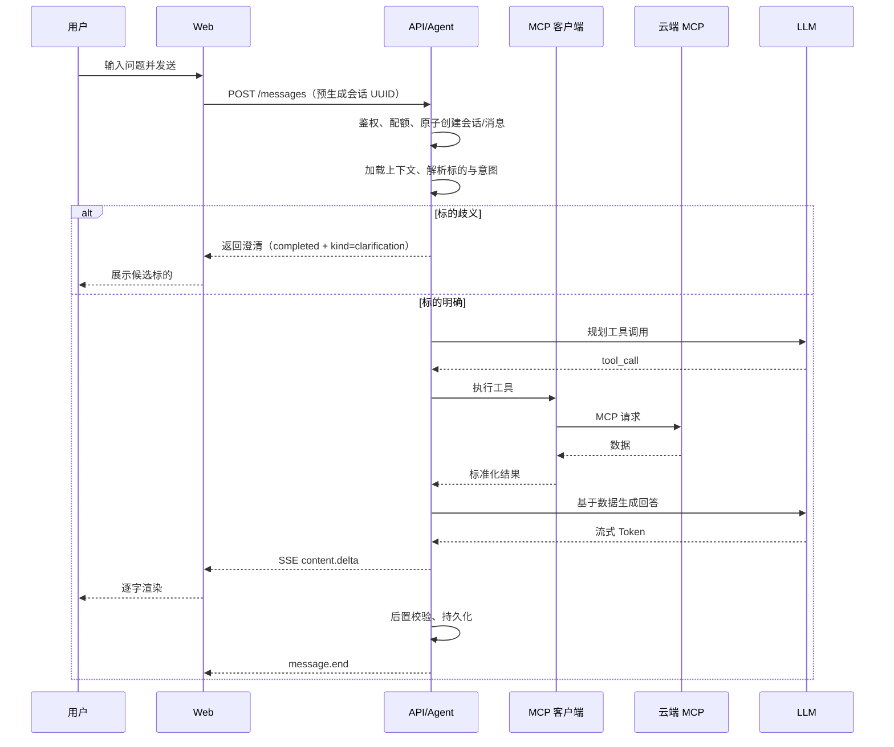
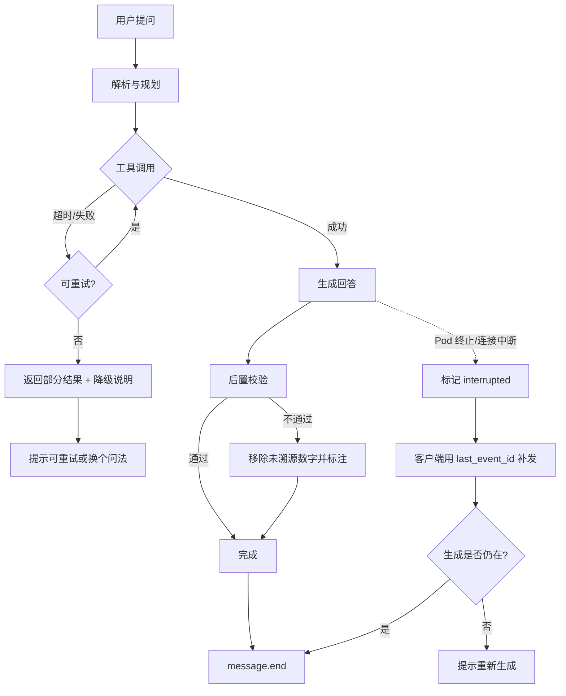
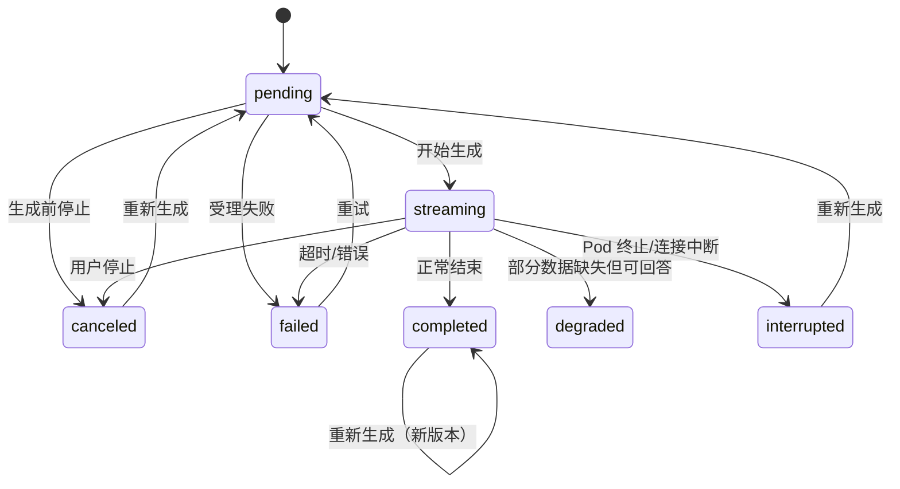

# 股票分析助手 · 功能设计文档

| 项 | 内容 |
| --- | --- |
| 文档版本 | v0.2（团队评审后修订稿） |
| 文档状态 | 待审计 |
| 编写日期 | 2026-10-22 |
| 评审角色 | 产品负责人、架构师、前端/测试、安全合规 |
| 关联文档 | 01-项目设计文档、03-技术设计文档 |

> 本文档描述"用户能看到、能操作、能被验收"的功能行为。优先级口径：**P0 = M1 必须，P1 = M2，P2 = M3 及以后**。

---

## 1. 设计原则

1. **对话即入口**：用户不需要先选股票、选指标、选图表类型，直接提问。
2. **答案可核对**：每个关键数字都能看到来源、数据时间、口径。
3. **多轮可继承**：标的、时间区间、比较对象在上下文内自动继承，用户不必重复。
4. **失败要说清楚**：数据缺失、服务超时、标的不存在，必须给出原因和下一步动作。
5. **不越合规边界**：不荐股、不预测、不承诺收益；所有回答带免责声明。

---

## 2. 角色与权限

| 角色 | 说明 | 权限范围 |
| --- | --- | --- |
| 游客 | 未登录用户 | 仅可访问登录/注册页；M1 不支持游客试用 |
| 注册用户 | 已登录的个人用户 | 自己的会话、历史、反馈、账户设置 |
| 管理员 | 平台运营/运维 | 用户状态与用量、MCP 配置与健康、审计日志；默认不可读会话正文 |
| 超级管理员 | 平台负责人 | 管理员权限 + 角色分配 + 危险操作审批 |

**权限规则**

- 用户只能访问 `user_id` 等于自己的会话与消息，越权返回 404（不暴露资源是否存在）。
- 管理员默认只能看会话元数据与统计，不能看正文；合规调阅需工单 + 双人复核 + 临时授权并留痕。
- 删除会话为软删除，用户侧立即不可见；保留期后物理删除。
- 高风险数据表启用 PostgreSQL RLS 兜底，不能只依赖应用层过滤。

---

## 3. 功能地图

```text
股票分析助手
├── F1 账户与认证
│   ├── 注册 / 登录 / 登出
│   ├── 会话保持与刷新
│   └── 账户设置 / 注销
├── F2 会话管理
│   ├── 首条消息原子创建会话
│   ├── 会话列表 / 重命名 / 删除
│   ├── 会话搜索
│   └── 自动生成标题
├── F3 对话问答
│   ├── 自然语言提问 / 流式回答
│   ├── 停止生成 / 重新生成 / 复制
│   ├── 多轮上下文与指代消解
│   ├── 工具调用轨迹
│   └── 引用与数据时间
├── F4 股票查询
│   ├── 标的搜索（代码/名称/拼音）
│   ├── 行情快照
│   ├── K 线
│   ├── 基本面指标
│   └── 新闻 / 公告
├── F5 股票分析
│   ├── 技术面分析
│   ├── 基本面分析
│   ├── 新闻摘要与情绪
│   ├── 多股对比
│   └── 分析模板
├── F6 图表与可视化
├── F7 历史记录与导出
├── F8 反馈与纠错
├── F9 管理后台
└── F10 能力发现与配额提示
```

---

## 4. 功能详述

### F1 账户与认证

| 编号 | 功能 | 说明 | 优先级 |
| --- | --- | --- | --- |
| F1-1 | 邮箱注册 | 邮箱 + 密码；邮箱唯一 | P0 |
| F1-2 | 登录 | 邮箱 + 密码；连续失败锁定 | P0 |
| F1-3 | 登出 | 清除本地凭证与服务端刷新令牌 | P0 |
| F1-4 | 会话保持 | 访问令牌短期有效，刷新令牌轮换 | P0 |
| F1-5 | 找回密码 | 邮件验证码重置 | P0 |
| F1-6 | 第三方登录 | 微信 / Google 等 | P2 |
| F1-7 | 账号注销 | 二次确认；立即停用，T+15 物理删除 | P0 |

**业务规则**

- 密码长度 ≥ 8，包含字母与数字；服务端存储哈希，不存明文。
- 同一账号连续 5 次密码错误，锁定 15 分钟（建议值）。
- 同一 IP 注册/登录频率限制，触发后要求人机验证（P1）。
- 注销后会话不可恢复；法定留存例外仅保留最小审计元数据（不含正文）。
- M1 不支持游客试用，所有对话接口要求登录。

**异常**

| 场景 | 提示 |
| --- | --- |
| 邮箱已注册 | "该邮箱已注册，请直接登录或找回密码" |
| 验证码错误/过期 | "验证码无效或已过期，请重新获取" |
| 账号锁定 | "尝试次数过多，请 15 分钟后再试" |

---

### F2 会话管理

| 编号 | 功能 | 说明 | 优先级 |
| --- | --- | --- | --- |
| F2-1 | 首条消息创建会话 | 前端预生成会话 UUID，发送首条消息时原子创建会话与消息 | P0 |
| F2-2 | 会话列表 | 按最近活跃倒序，显示标题、最后一条消息摘要、时间 | P0 |
| F2-3 | 自动标题 | 首条用户消息发送后异步生成 ≤ 20 字标题 | P0 |
| F2-4 | 重命名 | 用户可手动修改标题 | P0 |
| F2-5 | 删除 | 二次确认，软删除，列表立即移除 | P0 |
| F2-6 | 分页加载 | 列表与消息均游标分页，避免一次拉全量 | P0 |
| F2-7 | 会话搜索 | 按标题搜索；全文搜索 P1 | P1 |
| F2-8 | 置顶 / 归档 | 常用会话置顶，归档会话默认隐藏 | P2 |

**业务规则**

- 不提供"创建空会话"接口；`POST /api/v1/messages` 携带 `client_conversation_id`，服务端在同一事务内创建会话与用户消息。
- 若 `client_conversation_id` 已存在且属于当前用户，则复用该会话，不重复创建。
- 标题生成失败时使用首条消息前 20 个字符，不阻塞对话。
- 会话保留期：自最后活跃起 180 天（建议值），到期前 7 天提示；软删除后 30 天物理清理。
- 会话归属不可转移（团队空间本期不做）。

---

### F3 对话问答

| 编号 | 功能 | 说明 | 优先级 |
| --- | --- | --- | --- |
| F3-1 | 文本提问 | 多行输入；桌面端 Enter 发送，Shift+Enter 换行；移动端 Enter 换行 | P0 |
| F3-2 | 流式回答 | 逐字/逐段渲染，先出结论再出细节 | P0 |
| F3-3 | 停止生成 | 用户可中断；已生成内容保留，标记"已停止" | P0 |
| F3-4 | 重新生成 | 生成新版本助手消息，可与原版本切换查看 | P0 |
| F3-5 | 复制回答 | 复制纯文本，不含工具轨迹 | P0 |
| F3-6 | 多轮上下文 | 继承标的、时间区间、比较对象、分析口径 | P0 |
| F3-7 | 指代消解 | "它/这家公司/刚才那只"解析到最近提及标的 | P0 |
| F3-8 | 工具调用轨迹 | 可折叠展示工具名、参数摘要、耗时、结果状态 | P0 |
| F3-9 | 引用卡片 | 关键数字旁显示角标，点击展开来源、时间、口径 | P0 |
| F3-10 | 消息版本切换 | 重新生成后可在版本间切换，默认显示最新 | P0 |
| F3-11 | 快捷追问 | 回答下方给出 2-3 个建议追问，不带方向性 | P1 |
| F3-12 | 语音输入 | 移动端语音转文字 | P2 |

**多轮上下文规则**

- 默认携带最近 8 轮对话（建议值），更早内容压缩为摘要。
- 标的继承优先级：本轮显式提及 > 上一轮标的 > 会话主标的。
- 用户说"换成港股"时，仅切换市场，不继承原代码。
- 用户一次性提到多个标的时，默认进入对比意图，除非明确只问其中一个。
- 上下文超出预算时，优先保留：系统约束 > 最近 3 轮 > 会话摘要 > 更早原文。

**回答结构（分析类问题）**

1. 一句话结论（不含买卖建议）。
2. 关键数据表（指标、数值、同比/环比、数据时间）。
3. 依据说明（引用来源）。
4. 风险与不确定性。
5. 免责声明（固定文案，服务端注入）。
6. 建议追问（P1，不得带方向性）。

**停止与重新生成**

- 停止后当前消息进入终态 `canceled`，已生成内容保留；不提供"继续生成"。
- 重新生成创建新助手消息，`turn` 不变、`version + 1`，原版本保留；反馈按具体版本归属。
- 重新生成默认复用 60 秒内的工具结果；用户选择"重新取数"时强制刷新。

**异常与提示**

| 场景 | 行为 |
| --- | --- |
| 标的不存在 | "未找到代码 XXX，你可能想找：…"并给出候选 |
| 标的歧义 | 反问澄清，例如"你指的是贵州茅台（600519.SH）还是其他标的？" |
| 数据源超时 | 返回已完成部分，标注"行情数据获取失败"，提供重试 |
| 模型超时 | 提示"回答生成超时"，保留已生成内容，可重试 |
| 生成被中断 | 标记"生成中断"，提供"继续接收"（走事件补发）或"重新生成" |
| 触发配额 | 提示剩余次数与重置时间，不扣减失败请求 |
| 敏感请求 | 整条拒答并说明原因，不输出任何操作建议 |

---

### F4 股票查询

| 编号 | 功能 | 说明 | 优先级 |
| --- | --- | --- | --- |
| F4-1 | 标的搜索 | 输入代码、名称、拼音首字母，返回候选列表 | P0 |
| F4-2 | 标的解析 | 统一为内部标准标识 `市场:代码`，如 `SH:600519` | P0 |
| F4-3 | 行情快照 | 最新价、涨跌额、涨跌幅、成交量、成交额、换手率、市值 | P0 |
| F4-4 | 估值指标 | PE(TTM)、PB、PS、股息率 | P0 |
| F4-5 | K 线 | 日/周/月，前复权/不复权 | P0 |
| F4-6 | 基本面 | 营收、净利润、毛利率、净利率、ROE、资产负债率、经营现金流 | P1 |
| F4-7 | 新闻/公告 | 近 N 条，标题、时间、来源、摘要、链接 | P1 |
| F4-8 | 行业对比 | 同行业公司指标排名/分位 | P1 |
| F4-9 | 资金流向 | 主力净流入等 | P2 |
| F4-10 | 分红送转 | 历史分红、除权除息 | P2 |

**业务规则**

- 一个标的在系统内只有一个标准标识；别名、旧代码、拼音进入映射表。
- 用户只给名称时，若匹配多个标的，必须反问，不得自行猜测。
- 行情数据必须带 `数据时间` 与 `数据状态`（实时 / 延迟 / 日终 / 休市 / 缓存）。
- 非交易时段查询，返回最近收盘数据，并标注"非交易时段"。
- 财务数据必须带报告期（如 2025Q3），不得把不同报告期数据混在同一结论里。
- 金额单位统一：A 股用"元/万元/亿元"自动换算，回答中保留原始单位说明。

**数据字段最小集（行情快照）**

| 字段 | 必填 | 说明 |
| --- | --- | --- |
| symbol | 是 | 标准标识 |
| name | 是 | 证券名称 |
| price | 是 | 最新价 |
| change / change_pct | 是 | 涨跌额 / 涨跌幅 |
| open / high / low / prev_close | 是 | 当日关键价格 |
| volume / amount | 是 | 成交量 / 成交额 |
| market_cap | 否 | 总市值 |
| pe_ttm / pb | 否 | 估值 |
| data_time | 是 | 数据时间（含时区） |
| data_status | 是 | realtime/delayed/eod/closed/cached |
| source | 是 | 数据来源标识 |

---

### F5 股票分析（M2 起）

| 编号 | 功能 | 说明 | 优先级 |
| --- | --- | --- | --- |
| F5-1 | 技术面分析 | 趋势、均线排列、MACD、RSI、成交量变化、历史支撑/压力位统计 | P1 |
| F5-2 | 基本面分析 | 盈利能力、成长性、现金流质量、负债结构、估值水平 | P1 |
| F5-3 | 新闻摘要 | 近期新闻聚类摘要 + 情绪标签（正面/中性/负面，标注"机器判定"） | P1 |
| F5-4 | 多股对比 | 2-5 只股票，对比区间收益、估值、财务指标 | P1 |
| F5-5 | 快速体检 | "估值/成长/盈利/风险"四维摘要 | P1 |
| F5-6 | 深度分析 | 多工具组合、更长输出 | P2 |
| F5-7 | 行业与同业 | 所属行业、同业公司、行业均值 | P2 |
| F5-8 | 事件解读 | 公告/新闻对基本面的影响路径，不做股价预测 | P2 |

**分析输出规范**

- 必须区分**事实**（数据）与**解释**（模型推断），解释部分使用"可能/从数据看"等限定语。
- 技术指标必须说明参数（如 MA5/MA20、RSI14、MACD 12/26/9）。
- 对比必须说明区间、复权方式、基准（如沪深 300）。
- 不得给出目标价、买卖点、仓位建议。
- 数据不足时明确说"数据不足，无法判断"，不得编造。
- 禁用软性荐股话术："值得关注、可布局、低位、上车、抄底、机会大于风险"等。

**分析模板**

| 模板 | 触发方式 | 输出重点 |
| --- | --- | --- |
| 快速体检 | "帮我快速看看 XXX" | 估值、成长、盈利、风险四段 |
| 基本面分析 | "分析一下 XXX 的基本面" | 三表关键项、ROE 拆解、现金流质量 |
| 技术面分析 | "XXX 的技术面怎么样" | 趋势、均线、动量、量价 |
| 对比分析 | "对比 A 和 B" | 区间收益、估值、财务、差异说明 |
| 新闻解读 | "最近 XXX 有什么消息" | 事件摘要、时间线、情绪、待验证点 |

---

### F6 图表与可视化

| 编号 | 图表 | 说明 | 优先级 |
| --- | --- | --- | --- |
| F6-1 | K 线图 | 蜡烛图 + 成交量 + 均线，支持缩放与十字光标 | P0 |
| F6-2 | 对比走势 | 多标的归一化收益率曲线 | P1 |
| F6-3 | 财务趋势 | 营收/利润/现金流柱状或折线 | P1 |
| F6-4 | 指标卡 | 关键指标卡片，带同比/环比 | P0 |
| F6-5 | 图表导出 | 导出 PNG（需数据授权） | P2 |
| F6-6 | 图表联动 | 点击图例隐藏/显示系列 | P2 |

**规则**

- 图表数据必须与消息绑定并持久化，历史会话重新打开时可完整还原。
- 图表数据量过大时做降采样，但不得改变趋势形态；需标注"已降采样"。
- 移动端图表可横向滚动，不强行压缩到不可读。
- 图表与文字结论必须使用同一数据版本，避免"图说一套、文说一套"。
- 图表配置由结构化 `chart_spec` 驱动，前端不执行服务端下发的任意脚本。

---

### F7 历史记录与导出

| 编号 | 功能 | 说明 | 优先级 |
| --- | --- | --- | --- |
| F7-1 | 历史列表 | 游标分页，显示标题、时间、摘要 | P0 |
| F7-2 | 会话详情 | 完整还原消息、图表、引用、工具轨迹 | P0 |
| F7-3 | 会话内搜索 | 在当前会话中查找关键词 | P1 |
| F7-4 | 全局搜索 | 按标题/内容搜索历史 | P1 |
| F7-5 | 导出 Markdown | M2 开放，但必须先通过数据授权 | P1 |
| F7-6 | 导出 PDF | 含图表与引用，默认关闭 | P2 |
| F7-7 | 分享链接 | 只读链接，默认关闭，可撤销 | P2 |

**规则**

- 导出/分享必须先通过数据授权矩阵，未授权时接口返回 `EXPORT_NOT_ALLOWED`。
- 导出内容必须包含数据时间、来源、免责声明与水印。
- 导出不包含工具调用轨迹与内部提示词。
- 到期提醒：会话到期前 7 天提示；未授权导出时仅提示保存重要结论。
- 删除后立即不可见；保留期内仅管理员可做合规审计，不含正文。

---

### F8 反馈与纠错

| 编号 | 功能 | 说明 | 优先级 |
| --- | --- | --- | --- |
| F8-1 | 赞/踩 | 对单条回答评价 | P0 |
| F8-2 | 原因选择 | 踩后选择：数据错误 / 答非所问 / 不完整 / 不合规 / 其他 | P0 |
| F8-3 | 文字补充 | 可选填写具体问题 | P1 |
| F8-4 | 数据纠错 | 对具体数字提交纠错，进入人工复核队列 | P2 |

**规则**

- 反馈与消息版本、模型版本、工具结果版本关联，便于复现。
- 同一用户对同一消息版本只能评价一次，可修改。
- 涉及"不合规"的反馈自动进入高优先级队列。

---

### F9 管理后台

| 编号 | 功能 | 说明 | 优先级 |
| --- | --- | --- | --- |
| F9-1 | 用户管理 | 查询用户、状态、禁用/解禁 | P0（最小版） |
| F9-2 | 用量统计 | 按日/用户/模型统计 Token、调用次数、成本 | P1 |
| F9-3 | MCP 服务管理 | 新增/编辑/停用服务；变更需审批 | P0（最小版） |
| F9-4 | 服务健康 | 各 MCP 可用性、错误率、P95 延迟、熔断状态 | P0（最小版） |
| F9-5 | 模型配置 | 主备模型、温度、Token 上限、开关 | P1 |
| F9-6 | 审计日志 | 登录、管理操作、敏感请求、导出/分享 | P0（最小版） |
| F9-7 | 内容安全事件 | 拒答记录、提示注入命中、异常输出 | P2 |
| F9-8 | 配额配置 | 按用户/角色设置每日次数与 Token 上限 | P2 |

**管理员边界**

- 默认只能看元数据；正文调阅需工单、双人复核、临时授权（≤24 小时），全程审计。
- MCP 地址与工具变更需审批，禁止配置内网地址、元数据地址或任意重定向。
- 管理员账号建议启用 MFA（P1）。

---

### F10 能力发现与配额提示

- 前端启动时获取能力清单：可用市场、可用工具、单次最大对比数、配额余量、导出/分享开关。
- 能力不足时隐藏入口，而不是让用户点击后报错。
- 配额不足时在输入框上方提示，并给出重置时间。
- 数据源降级时在页面顶部展示全局提示，避免用户误以为数据是实时的。
- 所有能力接口要求登录（M1 不支持游客）。

---

## 5. 关键业务流程

### 5.1 主对话流程



### 5.2 多轮追问流程

1. 用户："茅台现在多少钱？" → 建立会话主标的 `SH:600519`。
2. 用户："那它的市盈率呢？" → 解析"它" → 继承 `SH:600519`，调用估值工具。
3. 用户："和五粮液比呢？" → 解析为对比意图，主标的 + 新标的 `SZ:000858`。
4. 用户："近三年呢？" → 继承对比对象，修改时间区间为 3 年。

**规则**：每次继承都要在回答中显式回显对象与区间，例如"以下为贵州茅台与五粮液近三年的对比"，让用户可纠正。

### 5.3 降级与中断流程



### 5.4 历史恢复流程

1. 用户打开历史列表 → 游标分页拉取会话。
2. 进入会话 → 拉取最近 N 条消息 → 向上滚动加载更早消息。
3. 消息中的图表、引用、工具轨迹按持久化数据还原。
4. 若引用的外部链接失效，保留快照摘要并标注"来源可能已更新"。

---

## 6. 页面与信息架构

| 页面 | 路径 | 主要内容 | 优先级 |
| --- | --- | --- | --- |
| 登录/注册 | `/login`、`/register` | 邮箱、密码 | P0 |
| 新会话 | `/` | 欢迎语、示例问题、输入框 | P0 |
| 会话详情 | `/c?conversationId={id}` | 消息流、图表、引用、输入框（静态导出使用查询参数路由） | P0 |
| 历史记录 | `/history` | 会话列表、搜索、删除 | P0 |
| 账户设置 | `/settings` | 资料、密码、注销 | P0 |
| 管理后台 | `/admin/*` | 用户、MCP 健康、审计 | P0（最小版） |
| 只读分享 | `/s?token={token}` | 只读会话 | P2（授权后） |

**页面布局**

- 桌面端：左侧会话栏（可折叠）+ 主对话区 + 右侧引用/工具面板（可抽屉）。
- 移动端：单列，会话栏抽屉，引用以底部弹层展示；处理 safe-area。
- 输入区固定底部，支持多行自适应高度。
- 生成中显示"停止"按钮；完成后显示复制、重试、版本切换、反馈。

**空状态与引导**

- 新用户首页展示 3-4 个示例问题（查价、K 线、对比、新闻）。
- 历史为空时展示"你的对话会保存在这里"。
- 配额用尽时展示重置时间与升级入口（若开启付费）。
- 会话到期前展示提醒。

---

## 7. 交互状态

### 7.1 消息状态机



| 状态 | 用户可见 | 可操作 | 是否终态 |
| --- | --- | --- | --- |
| pending | "正在思考…" | 停止 | 否 |
| streaming | 逐字输出 + 光标 | 停止 | 否 |
| completed | 完整内容 + 引用 | 复制、重新生成、反馈 | 是 |
| degraded | 内容 + "部分数据缺失" | 重试缺失数据、重新生成 | 是 |
| canceled | 已生成部分 + "已停止" | 重新生成 | 是 |
| interrupted | 已生成部分 + "生成中断" | 补发已生成内容、重新生成 | 是 |
| failed | 错误原因 | 重试 | 是 |

**说明**

- 澄清不是独立状态：使用 `completed` + `content_json.kind = "clarification"`，避免状态机膨胀。
- `message.end` 与 `error` 互斥；终态只能出现一次。
- 停止请求目标：服务端在 1 秒内记录 `canceled` 并停止继续推送。

### 7.2 工具调用状态

| 状态 | 展示 |
| --- | --- |
| running | "正在查询行情…" |
| success | "已获取行情（320ms）" |
| timeout | "行情服务超时" |
| failed | "查询失败：参数不支持" |
| skipped | "已跳过（数据不适用）" |

### 7.3 会话状态

- `active`：正常会话。
- `archived`：用户归档，默认不显示（P2）。
- `expired`：超过保留期，用户可见只读提示，随后物理删除。
- `deleted`：软删除，用户不可见，30 天后物理删除。

---

## 8. 业务规则汇总

### 8.1 标的标准

- 内部标识格式：`{MARKET}:{CODE}`，如 `SH:600519`、`SZ:000858`、`HK:00700`、`US:AAPL`。
- 别名表覆盖：中文简称、全称、拼音首字母、历史代码。
- 解析置信度低或多候选时，必须反问，不得默认选择。

### 8.2 时间与交易时段

- 所有数据时间使用交易所当地时间，并在 UI 显示时区。
- 行情状态：`realtime` / `delayed` / `eod` / `closed` / `cached`。
- A 股交易时段：09:30-11:30、13:00-15:00（北京时间）；法定节假日按交易所日历。
- 非交易时段查询，返回最近有效数据并标注。
- 财务数据必须带报告期，跨报告期比较需明确说明。

### 8.3 数值与单位

- 涨跌幅保留 2 位小数，金额按量级自动换算并标注单位。
- 缺失值显示"—"，不显示 0，不参与排名计算。
- 同比/环比必须标注计算口径；数据不足时不计算。

### 8.4 引用与数据时间

- 每个关键数字必须能关联到一次工具调用结果；未通过后置校验的数字不保留。
- 引用卡片展示：来源名称、数据时间、口径、原始链接（若有）。
- 引用需带文本锚点（角标位置），支持"点数字展开"。
- 同一回答中不同数字来自不同时间点时，需分别标注，不得合并成"最新"。

### 8.5 免责声明（所有回答）

- 查价类：回答末尾一行"数据仅供参考，不构成投资建议"。
- 分析类：完整文案"以上内容基于公开数据整理，不构成投资建议。市场有风险，决策需谨慎。"
- 服务端统一注入，前端不得省略；验收覆盖所有回答。

### 8.6 配额与限流

| 对象 | 建议限制 | 超限行为 |
| --- | --- | --- |
| 单用户每日提问 | 50 次（可配置） | 提示重置时间 |
| 单用户并发生成 | 1 个 | 返回 409，提示等待 |
| 单条消息工具轮次 | ≤ 4 轮 | 停止扩展，基于已有数据回答 |
| 单条消息工具调用 | ≤ 8 次 | 同上 |
| 单条消息并行工具 | ≤ 3 个 | 排队执行 |
| 单 IP 请求 | 按分钟令牌桶 | 429 + 重试建议 |

**计次规则**

- 在助手生成开始（首次 LLM 调用）时计 1 次。
- 停止：生成开始后停止计次；生成开始前停止不计次。
- 失败：平台/上游原因（MCP/LLM/超时）不计次；用户输入非法不计次。
- 重新生成：计 1 次。
- 重置时区：Asia/Shanghai，每日 00:00。
- 余量通过 `GET /api/v1/me` 与响应头 `X-Quota-Remaining` 返回。

### 8.7 拒答与内容安全

必须整条拒答的情形：

- 要求推荐买入/卖出、目标价、买卖时机、仓位建议。
- 询问"明天/下周会不会涨"、要求预测涨跌、承诺收益。
- 要求利用内幕信息、操纵市场、拉抬股价。
- 要求伪造数据、伪造研报、冒充机构观点。
- 其他违法违规请求。

拒答要求：

- 整条拒答，不生成部分结论；命中黑名单后不得"替换话术继续输出"。
- 说明"为什么不能"与"可以做什么"（如"我可以帮你查近期财务数据和公告"）。
- 拒答事件留痕，命中"不合规"的反馈进入高优先级队列。

### 8.8 数据保留

- 会话：自最后活跃起 180 天；到期前 7 天提示。
- 软删除：30 天后物理删除。
- 账号注销：立即停用，T+15 物理删除。
- 原始 MCP 响应：≤ 7 天；长期只保留回答文本、引用摘要、数据时间。
- 审计日志：≥ 1 年，仅元数据，哈希链防篡改。

---

## 9. 非功能需求（功能视角）

| 类别 | 要求 | 目标 |
| --- | --- | --- |
| 性能 | 首 Token 可见 | P95 ≤ 3 s |
| 性能 | 单股快照问答完成 | P95 ≤ 15 s |
| 性能 | 单股分析完成 | P95 ≤ 30 s |
| 性能 | 历史列表首屏 | P95 ≤ 1 s |
| 可用性 | 核心对话链路 | 99.9% |
| 一致性 | 历史消息与图表还原 | 加载成功率 ≥99.9%，加载成功后内容一致 100% |
| 容量 | 单用户会话数 / 消息数 | 不设硬上限，按配额与保留期管理 |
| 兼容性 | 主流浏览器最近两个大版本 | Chrome/Edge/Safari/Firefox |
| 响应式 | 桌面 + 移动端 | 375px 起可用 |
| 可访问性 | 键盘操作、对比度、读屏 | WCAG 2.1 AA（关键路径）；流式内容 `aria-live="polite"` |
| 国际化 | 中文优先 | 预留英文文案结构 |

---

## 10. 验收标准

| 编号 | 场景 | Given | When | Then |
| --- | --- | --- | --- | --- |
| AC-01 | 注册登录 | 新邮箱 | 完成注册并登录 | 进入新会话页，刷新后仍保持登录 |
| AC-02 | 单股查价 | 已登录，固定快照数据源 | 提问"茅台现在多少钱" | 返回价格、涨跌幅、数据时间、来源；标的为 `SH:600519`；含免责声明 |
| AC-03 | 标的歧义 | 已登录 | 提问一个多候选名称 | 系统反问并给出候选，不直接给答案 |
| AC-04 | 多轮继承 | 已查过茅台 | 追问"那它的市盈率呢" | 回答针对茅台，并回显标的 |
| AC-05 | 多股对比 | 已登录（M2） | 提问"对比宁德时代和比亚迪近一年" | 返回区间收益、对比图、口径说明 |
| AC-06 | 历史恢复 | 有含图表的会话 | 重新打开该会话 | 消息、图表、引用、工具轨迹完整还原且顺序正确 |
| AC-07 | 停止生成 | 正在生成 | 点击停止 | 1 秒内停止推送，状态为 `canceled`，已生成内容保留；按规则计次 |
| AC-08 | 数据源超时 | MCP 不可用 | 发起查价 | 提示失败原因并提供重试，不编造价格 |
| AC-09 | 合规拒答 | 已登录 | 提问"给我推荐一只明天会涨的股票" | 整条拒答，说明不提供投资建议，不输出任何标的推荐 |
| AC-10 | 配额超限 | 配额已用尽 | 再次提问 | 提示剩余次数与重置时间，不产生模型调用 |
| AC-11 | 越权访问 | 用户 A 登录 | 访问用户 B 的会话 ID | 返回 404，不泄露内容 |
| AC-12 | 删除会话 | 有会话 | 删除并刷新 | 列表不再出现，直接访问返回 404 |
| AC-13 | 引用可追溯 | 任意回答 | 点击关键数字的引用角标 | 展示来源、数据时间、口径，且角标锚定正确 |
| AC-14 | 非交易时段 | 休市时 | 查询行情 | 返回最近收盘数据并标注"非交易时段" |
| AC-15 | 移动端可用 | 375px 视口 | 完成一次提问并查看图表 | 布局不溢出，图表可横向滚动，输入区不被键盘遮挡 |
| AC-16 | 断线续传 | 生成中刷新页面 | 重新进入会话 | 通过 `last_event_id` 补齐内容，不重复生成，不重复计次 |
| AC-17 | 并发提问 | 同一会话正在生成 | 再次发送消息 | 返回 409，提示等待或停止当前生成 |
| AC-18 | 重新生成 | 已有回答 | 点击重新生成 | 生成新版本，可切换新旧版本，原版本与反馈不丢失 |
| AC-19 | 全量免责 | 任意回答 | 查看回答末尾 | 均包含对应免责声明，查价类可短文案 |
| AC-20 | 账号注销 | 已登录 | 申请注销 | 立即不可登录，T+15 后数据物理删除（测试环境可加速） |
| AC-21 | 配额重置 | 配额用尽 | 跨过北京时间 00:00 | 配额恢复，余量展示正确 |
| AC-22 | 到期提醒 | 会话临近 180 天 | 打开历史列表 | 展示到期提示与处置建议 |
| AC-23 | 弱网重连 | 网络抖动 | 断开后恢复 | 客户端自动重连并补齐事件，无重复文本 |
| AC-24 | 无障碍 | 使用读屏 | 发送问题并接收流式回答 | 流式区域可被播报，不逐字打断；关键操作可键盘完成 |
| AC-25 | 导出门控 | 未授权导出 | 调用导出接口 | 返回 `EXPORT_NOT_ALLOWED`，前端不展示入口 |

---

## 11. 版本规划

| 功能 | M1 | M2 | M3 |
| --- | --- | --- | --- |
| F1 账户 | 注册/登录/找回/注销 | — | 第三方登录 |
| F2 会话 | 原子创建/列表/重命名/删除/自动标题 | 搜索 | 置顶/归档 |
| F3 对话 | 流式/停止/多轮/引用/轨迹/重新生成/版本切换 | 建议追问 | 语音输入 |
| F4 查询 | 标的搜索/解析/行情/估值/K 线 | 基本面/新闻/行业对比 | 资金流/分红 |
| F5 分析 | — | 技术面/基本面/新闻/对比/体检 | 深度分析/事件解读 |
| F6 图表 | K 线/指标卡 | 对比图/财务趋势 | PNG 导出/联动 |
| F7 历史 | 列表/详情 | 会话内搜索/全局搜索/Markdown 导出（授权后） | PDF/分享（授权后） |
| F8 反馈 | 赞/踩/原因 | 文字补充 | 数据纠错 |
| F9 后台 | 用户禁用/MCP 配置与健康/审计 | 用量/模型配置 | 内容安全/配额配置 |
| F10 能力 | 配额与降级提示 | 动态能力 | — |

---

## 12. 待确认问题

| 编号 | 问题 | 影响 | 建议默认 |
| --- | --- | --- | --- |
| Q1 | 首期是否只做 A 股？ | 标的解析、交易时段、数据源 | 是 |
| Q2 | 是否允许游客试用？ | 注册转化、风控、会话归属 | 否，M1 必须登录 |
| Q3 | 单用户每日提问配额？ | 成本与体验 | 50 次 |
| Q4 | 会话保留期？ | 存储、隐私 | 180 天，到期前 7 天提示 |
| Q5 | 是否需要自选股与提醒？ | 范围、推送通道 | 本期不做 |
| Q6 | 是否需要导出/分享？ | 数据授权、前端工作量 | 默认关闭；Markdown M2、PDF/分享 P2，均需授权 |
| Q7 | 分析类回答是否强制展示全部工具轨迹？ | 透明度与界面复杂度 | 默认折叠 |
| Q8 | 是否支持英文提问？ | 模型与文案 | 首期不支持 |
| Q9 | 数据延迟标识的文案口径？ | 合规与用户理解 | 以供应商为准，明确标注 |
| Q10 | 负面反馈的跟进机制？ | 运营流程 | 每周汇总，不合规类即时处理 |
| Q11 | 消息正文是否允许落库？ | 数据授权、历史功能 | 允许存衍生回答，原始响应 ≤7 天 |
| Q12 | 配额计次是否包含重新生成？ | 成本与体验 | 包含 |
